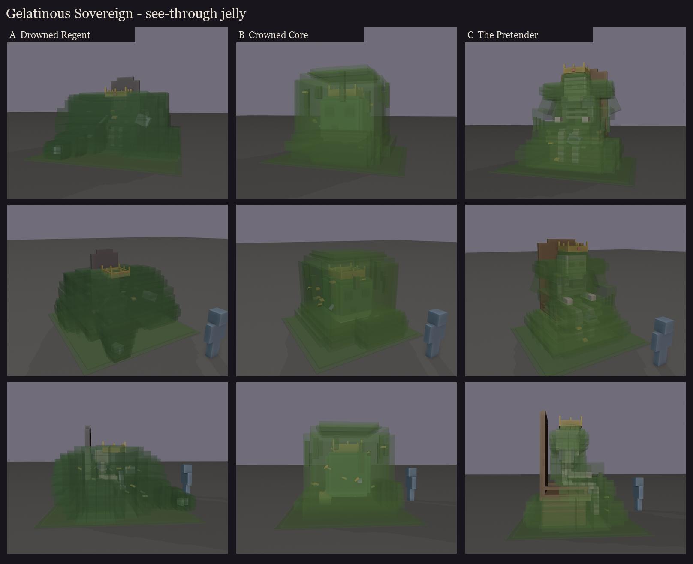

# Gelatinous Sovereign redesign, session 1: three directions

**The fight and the name are set** (`GelatinousSovereign.java`):
- a huge slime (a size-7 slime, about 3.6 blocks);
- it marks a player and leaps onto them, with a shockwave you jump;
- at 66% it splits off three shards that crawl back to the altar to heal it;
- at 33% it shrinks, speeds up and leaves acid puddles.

**The look is open.** All three directions keep the vanilla slime's idea, a see-through jelly with something solid
inside it, and each can show the split (a tear) and the shrink (the jelly burning off).

These are blockouts for picking a direction. In the colour views the jelly is drawn see-through; texture comes later.




| | Direction | Shape | Inside | At 33% | Size (w x h x d) |
|---|---|---|---|---|---|
| A | **Drowned Regent** | a low, wide, sagging dome of murky jelly; a pseudopod reaching forward with a swallowed gauntlet in its tip; the throne's tall back breaks out of the top | a dead king seated on his sunken stone throne; coins, helmets and a sword drifting round him. The crown sits outside, sunk halfway into the top | the jelly burns off and the king stands up | 5.6 x 3.7 x 5.8 blocks |
| B | **Crowned Core** | the vanilla slime made huge: one bevelled cube of clear jelly, sagging under its own weight (the base bulges, the front lip droops), goo running down its sides | a great dark core with the vanilla slime face (two square eyes, a small mouth), wearing the crown; swallowed treasure orbiting it | the outer jelly is gone: the crowned core is left, small and fast | 5.3 x 3.8 x 5.1 |
| C | **The Pretender** | the jelly has taken the shape of the king it ate: a robe spreading to the floor, a lap, shoulders, a head with the crown, arms resting on the throne's arms, slime fingers dripping off them; the throne's back rises behind its head | the real king's skeleton, seated in the same pose; a little treasure in its lap | the shape slumps and the skeleton walks out of it | 5.3 x 4.8 x 4.9 |

Sheets per direction: [A](A/sheet.png), [B](B/sheet.png), [C](C/sheet.png). Regenerate:
`python tools/art/bosses/sovereign_s1.py`.

**My read:**
- **B** is the most Minecraft: anyone sees a giant crowned slime at once, and its 33% state is the vanilla slime's
  inner core.
- **A** is the most story: a drowned court in a puddle.
- **C** is the most unsettling, and the strongest silhouette.

Parts can be mixed. For example, B's vanilla cube and face with A's seated king inside instead of a core, or C's
mimicry with A's murk.

## Check in game first: see-through jelly

Every direction depends on solid things showing through the jelly. BetterModel draws each bone as its own item
display, and Minecraft doesn't sort the see-through faces of separate entities against each other, so the inside may
vanish, or show through wrongly, from some angles. A tiny test model is on your server (port 25565) and the test
server, and loads cleanly. It's a 2-block jelly cube around an opaque core with a gold crown, and a loose bone.

```
/bm reload
/bm spawn occultech_jelly_test
```

Walk round it and look from above and below. The core, crown and bone should always show through the jelly, and the
jelly should never disappear behind them. If it breaks, the jelly can be painted as a frosted, mostly opaque skin with
see-through windows, and the session 2 design adapts.

Test model source: `python tools/art/bosses/sovereign_jelly_test.py` (never shipped).
