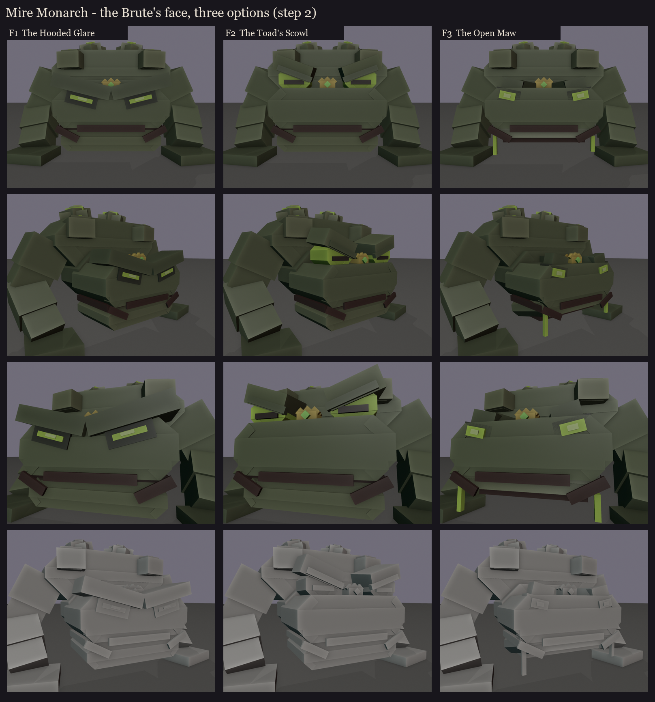

# Mire Monarch redesign, step 2: the Brute's face

The Brute posture was picked on 2026-10-11 (step 1: [../s1_silhouettes](../s1_silhouettes/README.md)). Here, three
faces sit on the same front half of the Brute (the shoulder yoke, the huge forearms, the glands), so each one is judged
in the frame it will live in.

All three share:
- a jaw as wide as the head under an overbite;
- a frown (the mouth line turns down at the corners);
- glow only in the eyes and the gland splits;
- a tiny crown between the eyes;
- about 80 cubes for this whole front half.

The colours are flat blockout colours. The eyes, the mouth line and the skin detail get painted in session 5.

| | Face | What it does |
|---|---|---|
| F1 | **The Hooded Glare** | A heavy V-shaped brow shelf with the eyes as thin glowing slits in its shadow; the mouth shut in a hard frown. The angriest and simplest, but the least toad-like: from the front it could be any brute. |
| F2 | **The Toad's Scowl** | The toad's own bulging eyes stay on top of the head, where vanilla's frog has them, but they are half shut under thick angry lids. The lower half glows round a dark horizontal frog pupil. It is clearly a toad and clearly furious, with the crown sitting between the lids. |
| F3 | **The Open Maw** | The jaw hangs open over the coiled glowing tongue (the tongue pull's tell), with toxic drips off the lip corners, bony cane-toad crests and small deep-set eyes. The open mouth hardly reads from the front at this angle, and the eyes are the weakest of the three. |

**My read:** F2. It keeps the toad (bulging eyes on top, frog pupils) while making it a monster, and its eyes
stay readable from a player's eye height. F3's open jaw can come back as an animation pose (the tongue's tell)
on whichever face is picked.

Regenerate with `python tools/art/bosses/monarch_face.py`.
