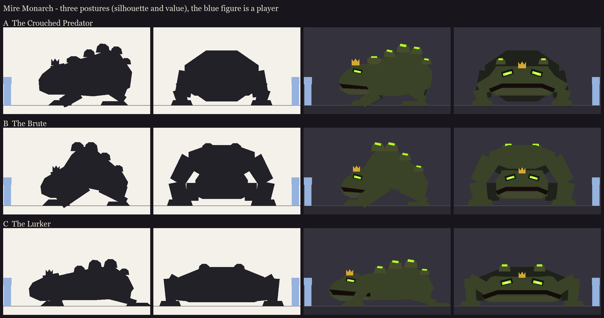

# Mire Monarch redesign, step 1: posture silhouettes

Take 5 (`../s1_concepts`) was rejected on 2026-10-11:
- the eyes looked horrible;
- the proportions were goofy, not intimidating;
- it had too many parts.

The agreed plan has three small gates: silhouettes (this step), then a face study, then one careful blockout.

**The brief:**
- a toad mutant monster;
- not vanilla geometry, but at home in Minecraft (a Dungeons-style mob or a good mod) and in the other bosses' style;
- vanilla ties: the frog colours, eye placement, webbed feet and the flat-plane tongue;
- radioactive and toxic, with large burst warts on its back;
- a tiny crown between its eyes;
- the tongue pull.

**Design rules on every posture:**
- **The mouth is the weapon:** a jaw as wide as the body, an overbite, slightly open, corners turned down.
- **The eyes:** small glowing slits, deep in shadow under a heavy brow, scowling (the inner ends dip).
- **Few big parts:** about 4 big warts, 2 glands, a wedge foot. Toes and small detail go to the texture.

| | Posture | Read |
|---|---|---|
| A | **The Crouched Predator** | Head low, level with the shoulders; forearms planted wide; the back rising to a hump of warts over the hips; hind legs coiled. The classic toad, made a predator. About 6.5 wide, 4 tall, 6 long (blocks). |
| B | **The Brute** | Built like a gorilla: a hump of muscle and warts over huge shoulders; enormous forearms planted ahead; the head hanging low and forward between them; a small coiled rear. The strongest triangle from the side, the most "mutant". About 6.5 wide, 4.3 tall, 5.8 long. |
| C | **The Lurker** | Low, long and very wide; the head nearly half its length and almost all mouth; elbows cocked high like a crocodile's; a ridge of big warts along a flat back. Menacing by width and mouth. About 8 wide, 3 tall, 8 long. |

The glow appears only in the eyes and the wart and gland splits.

Regenerate with `python tools/art/bosses/monarch_silhouettes.py`.
