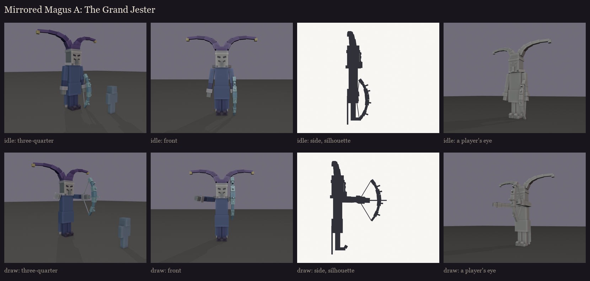
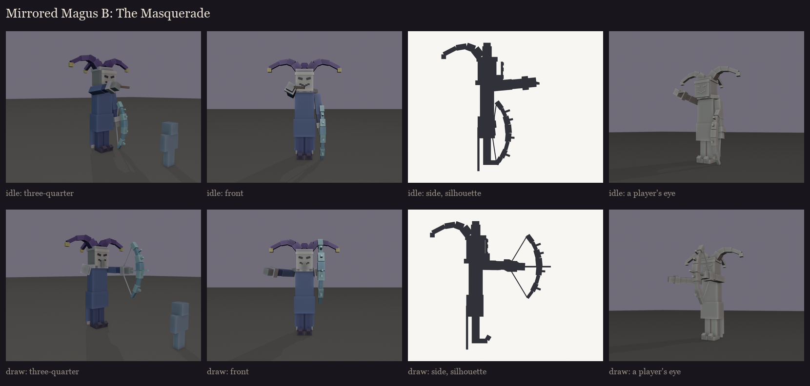
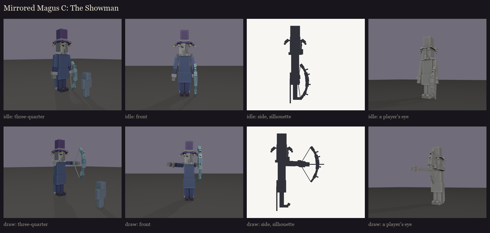

# The Mirrored Magus redesign, session 1: three takes on the user's direction

**The brief** (user, 2026-10-13):
- a slender, tall jester or harlequin magician, tall and looming, based on vanilla's Illusioner;
- a theatre mask;
- a bow made of glass and crystal shards.

**His fight** is unchanged (`MirroredMagus.java`):
- three-arrow fans;
- a warned prism burst;
- every 15 s, three decoys that look exactly like him.

So the model can carry no detail that only the real one has. His faint sparkle comes from the plugin.

**The shared body:** vanilla's IllagerModel at 1.8x, stretched slender:
- long legs and curled shoes;
- a long illusioner coat with three pointed harlequin tails at the back;
- a zigzag ruff collar;
- long arms with cuffs;
- the illager's long head and hanging nose.

**The crystal bow:** an arc of jagged glass shards of uneven size, with splinters jutting out and a bright string. He
holds it in his left hand, lowered when idle and drawn to aim. About 4.2 blocks to the top of his head, up to 5.5 to
the tips of his hat.

The takes differ in hat and mask. Each is shown idle and drawing the bow. The colours are blockout zones only. The
harlequin diamonds belong to the texture.

## A: the Grand Jester

A tall two-pointed jester hat curling outward with a bell at each tip, and a full theatre mask worn over his face.

## B: the Masquerade

A floppy three-pointed jester hat with bells, and the theatre mask held up before his face on a stick in his right
hand. He presses it to his face to aim.

## C: the Showman

A tall magician's hat ringed with jester points and bells, and a half mask over one side of his face.

Regenerate with `python tools/art/bosses/magus_silhouettes.py`.
