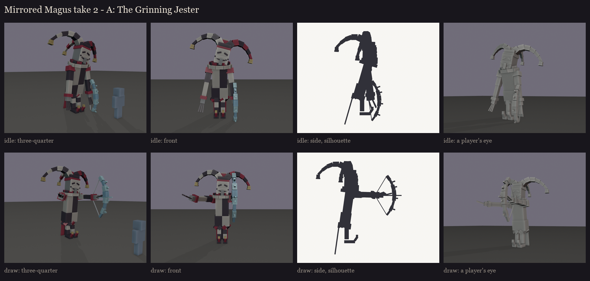
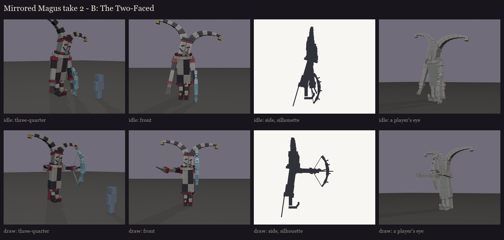
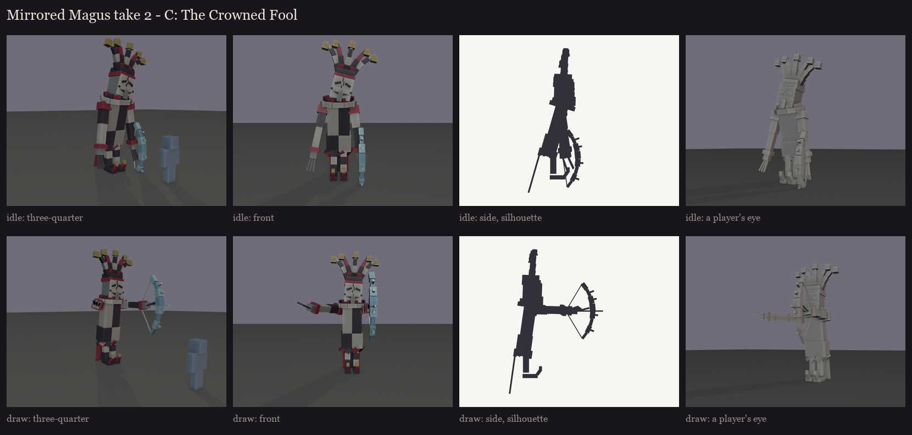

# The Mirrored Magus redesign, session 1: take 2 of the silhouettes

**Why take 2:** the user rejected take 1 ([../s1_silhouettes](../s1_silhouettes/README.md)). They asked for:
- a much better clown or jester hat;
- a little scarier;
- different colours: "harlequin jester / magician / clown, but scary".

**Kept:** tall and looming, vanilla's Illusioner underneath, a theatre mask, and the crystal-shard bow.

## Scarier, through shape and colour (all three takes)

- **The harlequin's colours:** black and bone white split down him, blood crimson, and tarnished gold bells. The
  crystal bow keeps its icy cyan.
- **His build:**
  - a gaunt, hunched lean with his head tilted to one side;
  - very long arms ending in clawed fingers;
  - stilt legs in black and white stripes;
  - long curled shoes with a bell.
- **The coat:**
  - split black and white, with crimson lining;
  - its hem cut into hanging points, with coat tails behind;
  - puffed crimson sleeves;
  - a big two-layer ruff.
- **The hat:** much bigger. Its heavy points are thick at the base and taper, they arc and droop, and each carries a
  bell at the tip.

## The takes

**A: the Grinning Jester.** Three long, floppy points drooping past his shoulders like tentacles. A full mask with a
grin from ear to ear and slanted eye holes.

**B: the Two-Faced.** Two huge striped points curling up and outward like horns, the classic jester outline. A split
mask, grinning on one side and weeping on the other, with a tear.

**C: the Crowned Fool.** Five points standing round his head like a crown, bells hanging. The grinning mask is cracked
down the middle.

Regenerate with `python tools/art/bosses/magus_take2.py`.
