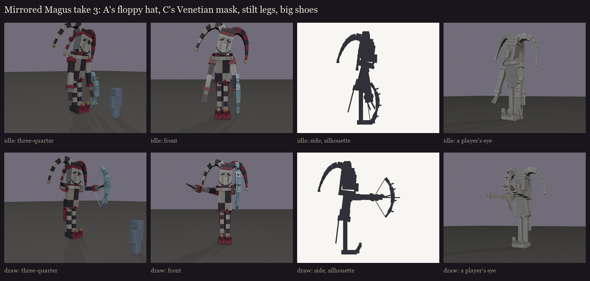
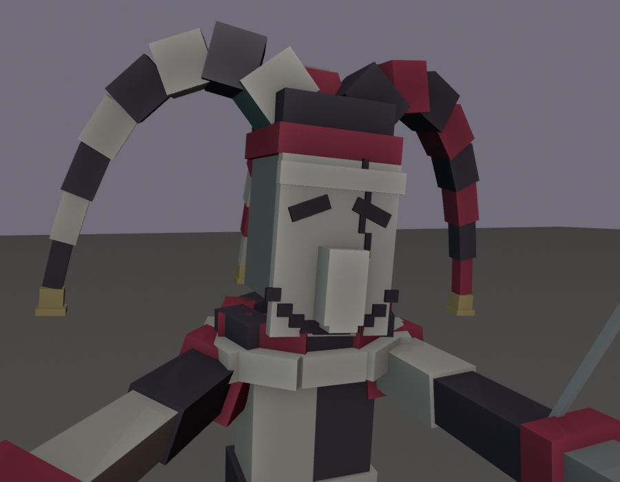

# The Mirrored Magus redesign, session 1: take 3, one design from the user's picks

What the user asked for, after take 2 ([../s1_take2](../s1_take2/README.md)):
- **The hat:** keep A's hat, the best looking, and make it even more floppy, with little bells at the ends.
- **The mask:** keep C's Venetian mask, the cracked grinning one.
- **The nose:** the illager's nose came through the mask. Either the smile goes below or round the nose, or there's
  no smile at all.
- **The build:** longer legs, a smaller midbody, big shoes.

- **The mask:**
  - **Nose:** it has its own long nose that sheathes the illager's, as Venetian masks do, so the nose no longer comes
    through.
  - **Chin and grin:** it covers his chin, and the grin runs beneath the nose tip and curls up both cheeks.
  - **Crack and eyes:** a crack runs from the brow down beside the nose, and the eye holes slant up and out.
  - **Placement:** his head now sits clear of the ruff, so the whole grin shows.
- **The hat:** three long, floppy points drooping hard past his shoulders and swinging out, thinning to little gold
  bells.
- **The build:** stilt legs in black and white stripes, a third longer than take 2's. A shorter split coat with its
  hanging points and tails. Big curled clown shoes in black and crimson with a bell. About 5.1 blocks to the top of
  his head, 6 to the top of the hat.

Regenerate with `python tools/art/bosses/magus_take3.py`.
