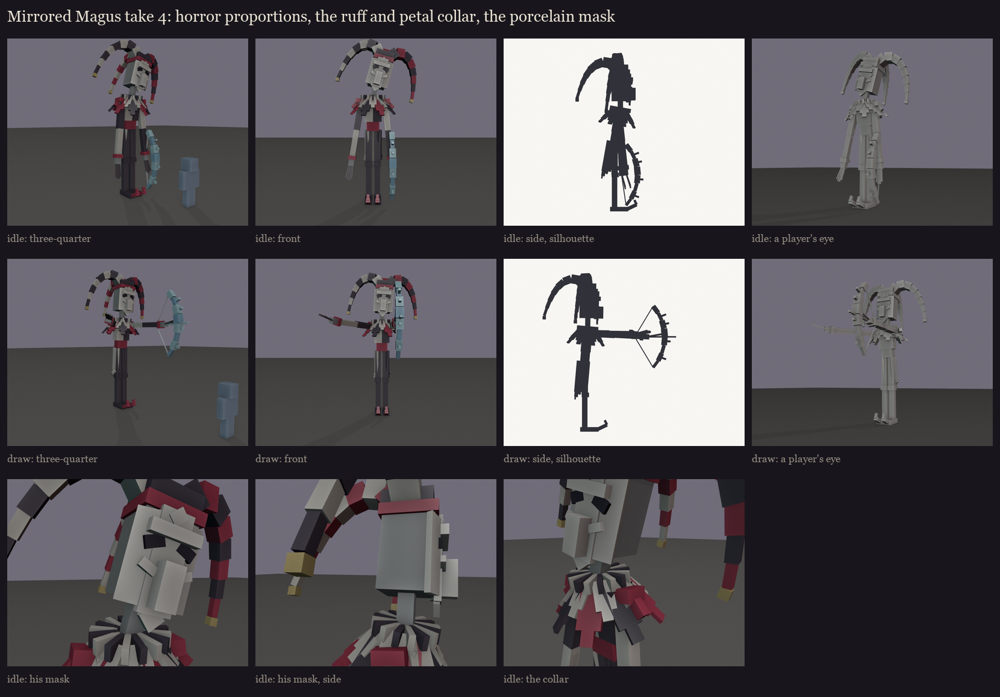

# The Mirrored Magus redesign, session 1: take 4, horror proportions

What the user said about take 3 ([../s1_take3](../s1_take3/README.md)):
- the smile belongs in the texture, because the modelled one looked awful;
- the collar needs to look much better, and the details overall;
- it looks too goofy: give it horror proportions, and a better mask.

- **The proportions:** a marionette's build.
  - **Body:** narrow shoulders, a cinched crimson corset at the waist, and a long thin neck. His long head is tilted
    to one side, with a slight hunch.
  - **Limbs:** stick-thin legs with knobbed knees. His arms are so long that his clawed fingers hang past his knees.
  - **Shoes:** long pointed shoes curling up at the tip, replacing the blocky clown shoes.
  - About 5.4 blocks to the top of his head, 6.5 to the top of the hat.
- **The coat:** long, cut into hanging points down to his knees round his sides and back, split black and white.
  Tight sleeves with pointed crimson shoulder caps.
- **The collar:** a pleated ruff close round his neck, with two layers of flat pointed petals fanned over his
  shoulders, chest and back: crimson and black outside, white inside.
- **The mask:** a porcelain Venetian face, curved round his.
  - **Shape:** a centre panel and two side panels turned back, a heavy brow with a widow's peak, deep sunken eye
    sockets slanting up and out, and high cheekbones.
  - **Nose and chin:** its own long nose sheathes the illager's, and it ends in a pointed chin.
  - **Not modelled:** the grin and the crack are left for the texture.
- **The hat:** take 3's three floppy points with little gold bells.
- **The bow:** the crystal-shard bow.

The colours are flat zones. The harlequin diamonds and the painted grin come with the texture.

Regenerate with `python tools/art/bosses/magus_take4.py`.
