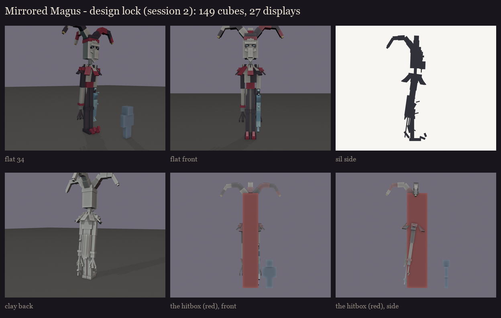
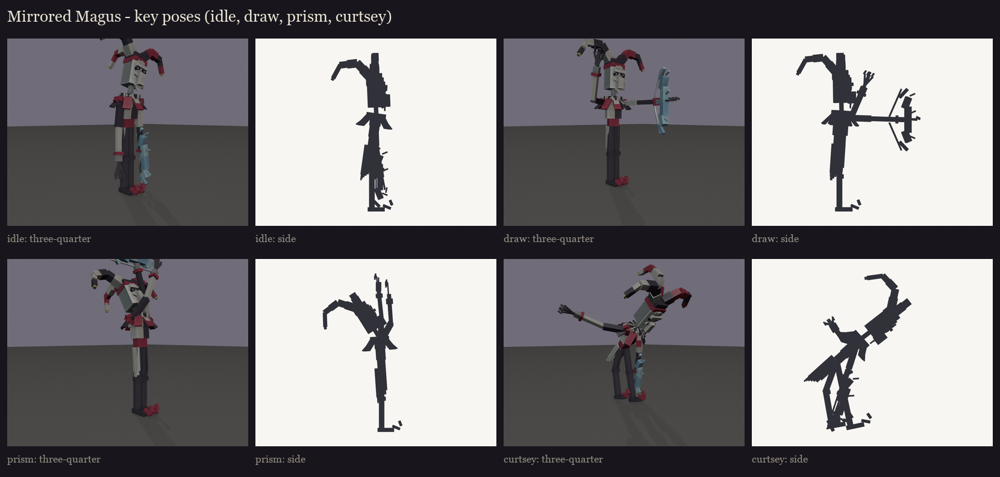
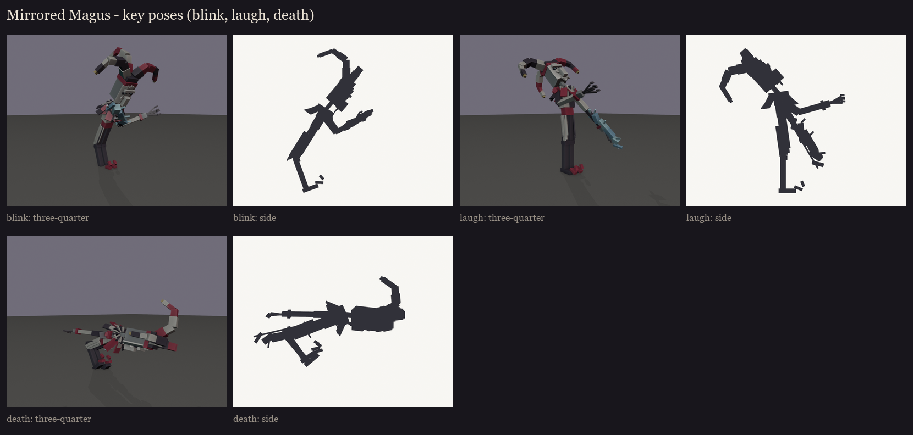

# The Mirrored Magus redesign, session 2: design lock

The approved take 4 ([../s1_take4](../s1_take4/README.md)) is rebuilt as a rig and locked: every cube is snapped to
whole texels, the hitbox is set, and he's posed for the fight's moments. The user wants to judge the mask again once
it's textured (session 5).

## Size and hitbox

- **Model:** about 5.4 blocks to the top of his head and 6.8 to the hat's peak.
- **Hitbox:** one invisible `ob_hitbox` bone, 1 x 6 x 1.3 blocks: a column over his legs, body and head. The hat's
  points, the arms, the coat's hanging points and the bow stay outside it.

## Bones (BetterModel names)

**The bones:**
- `hips`, `leg_*` and `shin_*`: the stick legs, with knees that bend;
- `torso`: the corset, ribs and chest, and the pleated ruff;
- `coat`: the hanging points, which sway;
- `collar` and `collar_diagonal`: the two layers of petals, those pointing straight out and those pointing
  diagonally. Each petal tips down with one turn of its own.
- `arm_*` and `forearm_*`: the long arms, with the clawed fingers on the forearms;
- `neck`, then `hi_head`: the head with the mask and the hat's band;
- `hat_left_0..2`, `hat_right_0..2` and `hat_back_0..2`: the three floppy points, each a chain of three bones so it
  can flop and swing;
- `bowstring_upper` and `bowstring_lower`: the string in two halves, pulled back on the draw.

**Glow bones, drawn full-bright:**
- `glow_bow`: the crystal bow, in the tier's cyan;
- `glow_eyes`: a cold glint deep in each of the mask's sockets.

Every copy has them, so they give nothing away. His faint sparkle comes from the plugin.

**Counts:** 149 cubes and 27 bones, so 27 displays. Four of him stand on the field at once (the real one and three
decoys), so every cube is axis-aligned or turned once by 22.5 or 45 degrees. None costs an extra display, and the
curves come from bones:
- **The hat's points:** chains of bones.
- **The bow:** shards snapped to 0, 22.5 and 45 degrees.
- **The ruff and the coat's points:** snapped to 22.5-degree steps.

Full list: [parts.md](parts.md).

**The bow** is turned to a world orientation in its poses, whatever his arm does: upright and facing the shot when he
draws, and held flat overhead for the prism.

## Key poses

- **Idle:** hunched, his head tilted, the bow hanging.
- **Draw** (the arrow fans): the bow drawn and upright, his mask turned to the shot.
- **Prism:** the bow raised flat overhead, the crystal gathering the light.
- **Curtsey** (conjuring the decoys): a deep courtly bow, one arm sweeping out.
- **Blink:** folding in on himself as he vanishes.
- **Laugh** (a wrong hit shatters a decoy): head thrown back.
- **Death:** the strings cut, knees buckling, folding forward.

Regenerate with `python tools/art/bosses/magus_s2.py`. The editable model with its hitbox is
`occultech_mirrored_magus_blockout.bbmodel`.
