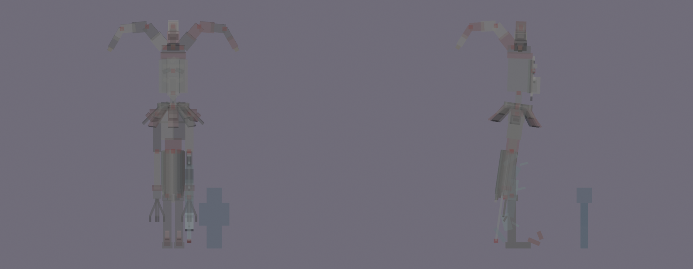

# The Mirrored Magus redesign, session 3: rig and pose test

The session 2 rig, checked and made loadable in game with a flat colour per material. The crystal bow and the glint
in his sockets are full-bright.

## Checks

- **Tags:** only the intended bones carry a BetterModel tag: `hi_head`, `glow_bow`, `glow_eyes` and `ob_hitbox`.
  None are missing and there are no strays.
- **Displays:** 27, one per bone. No cube is turned in a way that costs an extra display. 149 cubes. Four of him are
  on the field at once (the real one and three decoys), so about 108 displays for the encounter. The optimization
  pass for every boss comes once all of them are designed.
- **Pivots:** see [pivots.md](pivots.md) and the markers below (red, front and side).
  - **Joints:** every limb pivots in its joint: the hips, the knees, the shoulders, the elbows, the neck, and each
    link of the hat's points.
  - **Centre pivots:** four bones pivot at a centre on purpose. The coat sways from his waist, the two collar bones
    turn round his neck, and the eye glints never move on their own.



## In game

The review model `occultech_mirrored_magus_rig` loaded on the second test server with the shipped models and no
warnings (9 models). It is also in your server's BetterModel models folder. It's for review only and never shipped.

```
/bm reload
/bm test occultech_mirrored_magus_rig idle
/bm test occultech_mirrored_magus_rig draw
/bm test occultech_mirrored_magus_rig prism
/bm test occultech_mirrored_magus_rig curtsey
/bm test occultech_mirrored_magus_rig blink
/bm test occultech_mirrored_magus_rig laugh
/bm test occultech_mirrored_magus_rig death
```

The poses are held, not animated: the motion is session 7. The blink and the death sink his hips to the floor with a
position key.

Next, session 4: UV and material blocking, including the harlequin diamonds' layout and the mask's islands, so the
grin and the cracks can be painted.

Regenerate with `python tools/art/bosses/magus_s3.py` (after `magus_s2.py`).
