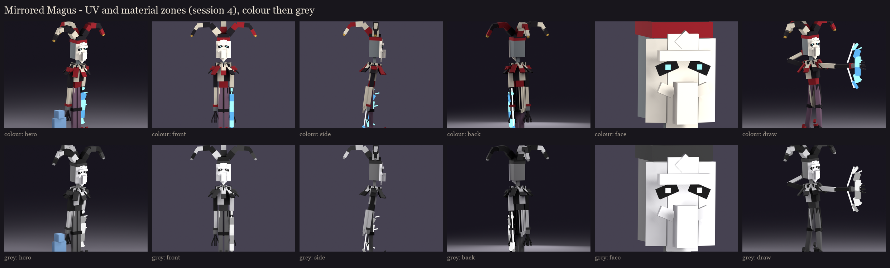

# The Mirrored Magus redesign, session 4: UV and material blocking

Every visible face of the session 3 rig is mapped at one texel per model unit (16 per block, the vanilla density) into
one 256x256 atlas.
- **Atlas:** 728 islands in 128 rows, 46% filled. Each island has a 1-pixel border against seams.
- **Buried faces:** 30 faces buried inside another cube of the same bone are left out.
- **Shared space:** a left part shares its right twin's texture space when both are the same size and the same
  material: his legs, shoes, knees, hands, fingers and the hat's links. The coat and sleeves are split black and white
  by side, so they don't.

## Material zones

The scary harlequin's colours.

| Zone | Colour | Where |
|---|---|---|
| black | 24, 20, 28 | half his coat, his sleeves and cuffs, the hat's cap, his knees and shoes |
| white | 206, 198, 180 | bone white, a step under the porcelain: the other half of the coat, the ruff, the inner petals |
| crimson | 138, 18, 32 | the corset, the shoulder caps, the hat's band, the outer petals, the shoe tips |
| gold | 176, 140, 60 | the tarnished bells |
| skin | 118, 124, 126 | the illager's grey: his neck, head and hands |
| nose | 100, 106, 108 | the illager's nose, under the mask's |
| porcelain | 236, 230, 216 | the mask |
| socket | 10, 8, 14 | the mask's deep eye sockets |
| leg | 118, 92, 112 | grey plum, lighter than the coat: the harlequin diamonds are painted over it |
| claw | 40, 34, 40 | his long fingers |
| crystal, crystal_dark | 150, 230, 250 and 90, 160, 210 | the bow (full-bright) |
| string | 230, 240, 255 | the bowstring (full-bright) |
| eye_glint | 150, 240, 255 | the glint deep in each socket (full-bright) |

**The value check:** every pair of neighbouring zones is at least 12 apart in lightness, so he reads in grey too.
- **Legs against black:** dark plum legs sat too close to his black knees and shoes.
- **Legs against crimson:** a lighter plum then sat too close to the crimson.
- **The fix:** there was no room between the black and the crimson, so the legs went lighter than both.

## Left for painting (session 5)

- **The harlequin diamonds:** black and white on his legs, sleeves and coat.
- **The mask:** the grin, the cracks and the stains. The user will judge the mask again here.
- **The rest:** the folds of the cloth, the gleam on the bells, and the shards' facets.

**In game:** the review rig on your server is updated with this atlas: `/bm reload`, then
`/bm test occultech_mirrored_magus_rig draw`.

Regenerate with `python tools/art/bosses/magus_s4.py` (after `magus_s3.py`).
