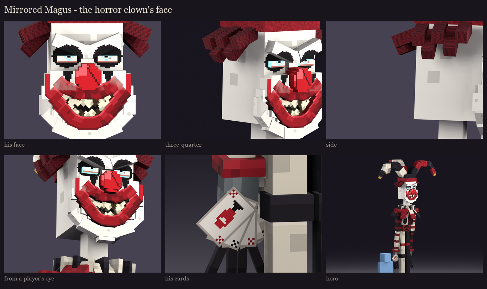
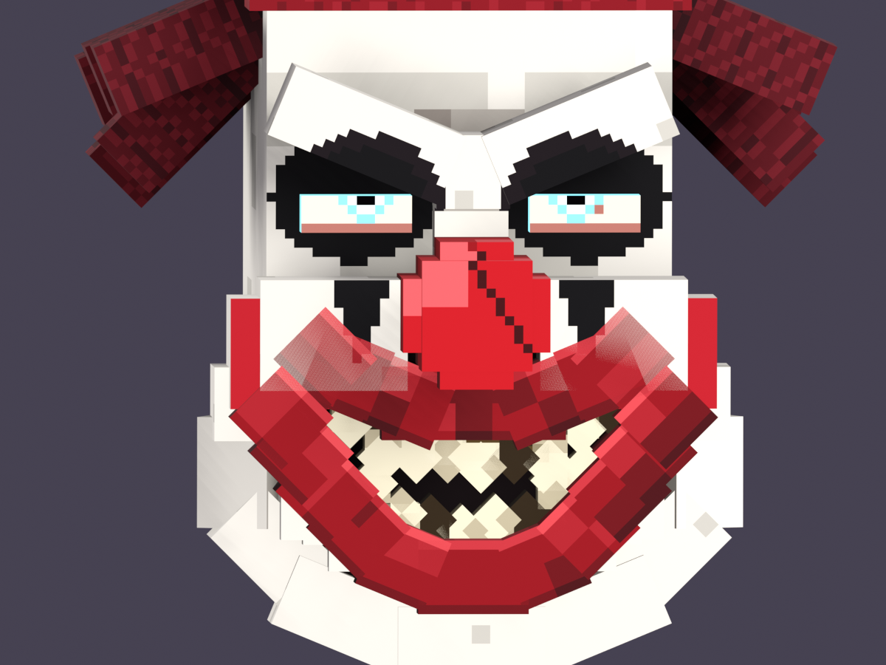

# The Mirrored Magus redesign, session 5: the horror clown's face

The user rejected all three masks of the study ([../s5_masks](../s5_masks/README.md)): "much more pronounced,
detailed, and full of depth... focus on the face. It should be a horror clown face." So he has no mask: this is his
own face, a horror clown's, sculpted in depth out from the illager's head (`magus_s2.mask_clown`) and painted.

**Sculpted:**
- **The brow:** heavy, pinched down in the middle into a glare.
- **The eyes:** deep sockets behind the brow.
- **The cheeks:** high cheekbones, with cheeks pushing up into the grin.
- **The nose:** a bulbous red clown's nose.
- **The muzzle:** a low muzzle under the nose that carries the painted grin.
- **The chin:** long and pointed.
- **The hair:** wild tufts sticking out from under his hat.

**Painted at a higher resolution:** his head, face and eyes are textured at 4 texels per model unit (64 per block, four
times the rest of him; `magus_s4.density`). This is a deliberate exception to the vanilla density, at the user's
request.
- **The greasepaint:** white and finely cracked, wrapping round his cheeks onto the sides of his head.
- **Black:** round his eyes, with a black diamond running down from each.
- **The grin:** smooth, thick red lips round an open, dark mouth stretched up into his cheeks.
  - **Teeth:** rows of pointed teeth along both lips, with gaps between them and longer fangs at the corners.
  - **Drips:** a thin red drip from each corner.
- **The eyes:** an illager's eyes, on the glow bone so they stare out full-bright from the black round them:
  - a pale white, faintly bloodshot;
  - a cyan iris;
  - a dark pupil looking a little inward.
- **The nose:** glossy red, with a highlight and a crack.

**Take 2** (after the user's notes: the smile was too blocky and busy, the eyes should be more human or illager-like,
the teeth looked weird, and the head's resolution should go up): the lips built cube by cube and the cube teeth were
replaced by the painted grin; the eyes became illager eyes; and the head got its higher resolution. 157 cubes.

## Take 3

The user's notes: the chin looked odd; it should be his actual face, not a mask; the mouth should be full of actual
nasty-looking teeth; the smile should sit properly on the face, with the chin and cheeks designed round it with the
makeup; more hair. They also changed his weapon.

- **His own face:**
  - **The head:** his whole head is in white greasepaint now, not grey with a white front.
  - **The lower face:** the flat muzzle plate and the pointed chin are gone. His lower face is a jaw, its sides
    bevelled round the corners of his face, with a rounded chin under it.
  - **The cheekbones** frame the grin.
- **The makeup and the mouth:**
  - **Makeup:** a big red clown's mouth is painted wide across his face and up into his cheeks.
  - **Mouth:** inside the makeup is his real mouth, with dark crimson lips round a black throat.
  - **Teeth:** the mouth is packed with nasty teeth. Each one has its own width, length and crooked lean. They're
    yellowed, brown at the tips or rotten through, some broken off or missing, with fangs among them. They sit over
    bleeding gums, with a darker second row behind.
  - **Drips:** a red drip runs from each corner.
- **The hair:** a full ring of wild crimson tufts in two rows, round his sides and back under the hat.
- **His weapon: a hand of playing cards** (the user: in place of the crystal bow; he throws them out instead of
  arrows).
  - **The fan:** five cards fanned in his right palm, each a flat plane, painted at the head's resolution.
  - **Faces:** a spade, a heart, a diamond, a club and a grinning joker, with corner indices.
  - **Backs:** crimson with a black diamond lattice and a gold border.
  - **Poses:** the bow's draw pose became the throw (a twist and a flick, his arm flung out at the target), and the
    prism holds the fan up overhead.
  - **In the fight:** throwing the cards in place of his arrows is for session 8.
- **Counts:** 163 cubes, 25 displays (the bow's three bones are gone). Sessions 2 to 5 were regenerated with the face
  and the cards.

## Take 4: the mouth, built

The user: make the mouth an actual big mouth with actual teeth, not a texture on a mask. The painted grin looked
wrong because it wrapped round blocky shapes, so the mouth is now built from blocks shaped round it
(`magus_s2.mouth`):
- **The grin:** a big gaping grin with a gently curved upper lip and a deep U of a lower lip, meeting at the corners
  up in his cheeks.
- **The lips:** thick red lips, each a few segments turned along the grin by free angles, overlapping so the curve
  stays whole.
- **The teeth:** real teeth inside, each a block with a pointed tip (a turned square), of its own width and length.
  - **Rows:** they hang from the upper lip and rise from the lower, set back behind the lips' front.
  - **Fangs:** among them.
  - **Paint:** yellowed, brown at the gum, some rotten through.
- **The throat:** a dark block behind the teeth.
- **Round the mouth:** a long jaw hanging below, with its sides bevelled, the chin under it, and the cheeks above the
  corners.
- **The paint:** each block gets its own plain paint (glossy lips, teeth, white greasepaint with the clown's red
  spreading past the lips onto the cheeks and jaw), so nothing wraps round corners.

**Counts:** 219 cubes and still 25 displays (every lip segment is turned by a free angle). The atlas is now
256x1024, because the head's higher resolution covers more blocks. That's for the optimization pass once all the
bosses are designed. Sessions 2 to 5 were regenerated.

**Take 4c** (the user: the black below the lips looked odd, fix the cheeks; and the angled hair from before looked
better):
- **Under the lower lip:** white flesh now follows the lower lip's U down to the jaw, so the throat's black only shows
  inside the mouth.
- **The cheeks:** they round out high over the corners.
- **The lips:** their ends are trimmed to tuck in under the cheeks.
- **The hair:** the angled tufts are back, and more of them: five a side tilted out and down at different heights and
  depths, and three angled down at the back.

**Take 4d** (the user: the bottom of the face and the neck looked out of proportion; angled blocks for the jaw, and a
little smaller mouth):
- **The mouth:** smaller - narrower (corners at about 5 instead of 6.2 from the middle), not as deep, with thinner lips -
  so it no longer hangs far below the head.
- **The jaw:** no long, wide bar and chin any more. Angled blocks narrow in a V from under the cheeks (corners turned 45
  degrees, the sides beside the chin 22.5) down to a small chin, just below the head.
- **The neck:** thicker (4 instead of 3) and white like his face, so it doesn't read as a grey stalk under a white head.

Regenerate with `python tools/art/bosses/magus_clown.py`.
