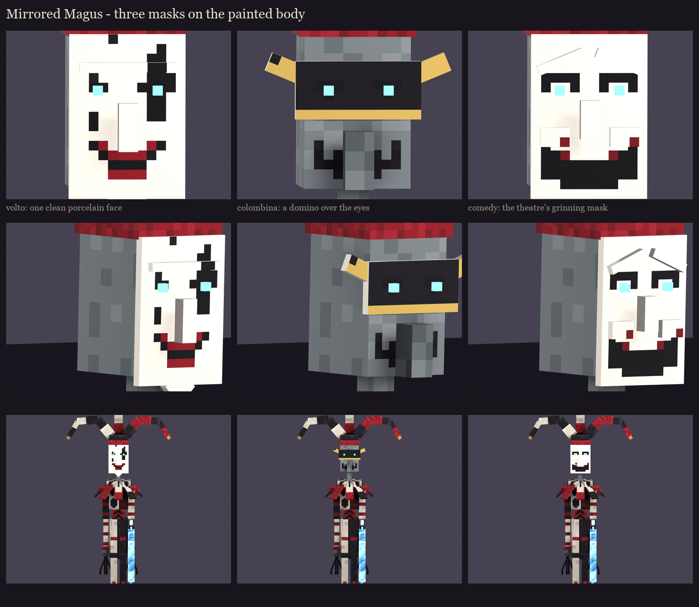

# The Mirrored Magus redesign, session 5: a mask study

The user loves the painted body, arms, legs and hat, and disliked the panelled porcelain mask entirely (2026-10-13).
So here are three new masks on the same painted body, for a pick. Each is a simple shape in front of his face, with
its features painted.

- **Volto:** one clean, smooth porcelain face with a low brow, a small nose and a pointed chin. Painted on it:
  - a black harlequin diamond through his left eye;
  - a black tear under his right;
  - small blood-red lips in a thin grin;
  - a hairline crack.
- **Colombina:** a black domino over his eyes only, its wings swept up and out, trimmed in gold. Below it are the
  illager's own long nose and grey face, with a grin stitched across them.
- **Comedy:** the theatre's comedy mask, with brows arched high and raised cheeks. Painted on it are crescent eyes that
  smile and a huge grinning mouth, a black void with a crimson rim.

All three keep the cold cyan glint deep in his eyes. The masks are `magus_s2.MASKS`, and the painting is
`magus_s5.paint_mask`. Regenerate with `python tools/art/bosses/magus_masks.py`.
