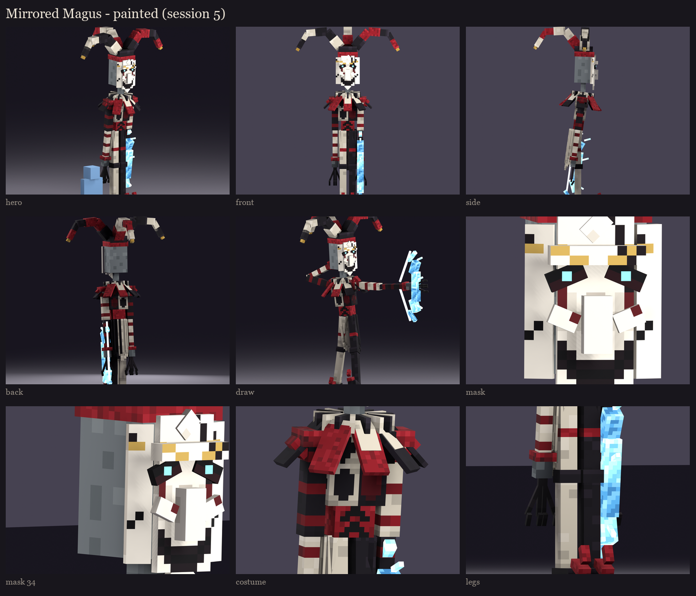

# The Mirrored Magus redesign, session 5: texture painting

The session 4 layout painted. This is where the user judges the mask again.

## The costume

The harlequin, in what this size can hold. At 4 texels across a limb, true diamonds broke into pixel crosses in the
first pass, so:
- **The chest:** one large diamond on each half, in the opposite colour: crimson on his black half, black on his white
  half.
- **The sleeves:** crimson bands round them.
- **The legs:** split by colour, his left black and his right bone white, with a crimson garter at the thigh. They
  keep their own texture (not mirrored) for that.
- **The cloth:** soft noise, and the coat's hanging points darker at their edges.
- **Crimson velvet:** for the corset, caps, petals, hat band and shoe tips. The corset is laced across in black.
- **The bells:** tarnished gold, bright on top, with a dark slit.

## The mask

**The geometry changed (session 2 regenerated)** to make room for a mouth:
- the illager's nose, hidden under the mask, is dropped;
- the mask's own nose is short and sharp, like a Venetian volto's;
- the mask is wider.

**Painted on clean old porcelain:**
- **The grin:** a stitched grin, a thin black line from cheek to cheek below the nose with stitches across it, curling
  up into the cheeks;
- **The gold:** a fine gold arc over each eye, sweeping up and out;
- **The rest:** two thin cracks past his left eye, and a thin dark drip from each socket.

## The bow

Crystal facets in light and dark bands with bright edges. The string is pale.

The review rig on your server has the painted texture: `/bm reload`, then
`/bm test occultech_mirrored_magus_rig idle`.

Regenerate with `python tools/art/bosses/magus_s5.py` (after `magus_s4.py`; sessions 2 to 4 first if the mask
geometry changes).
