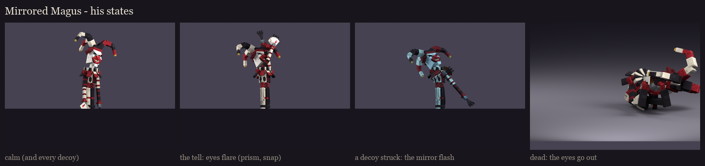
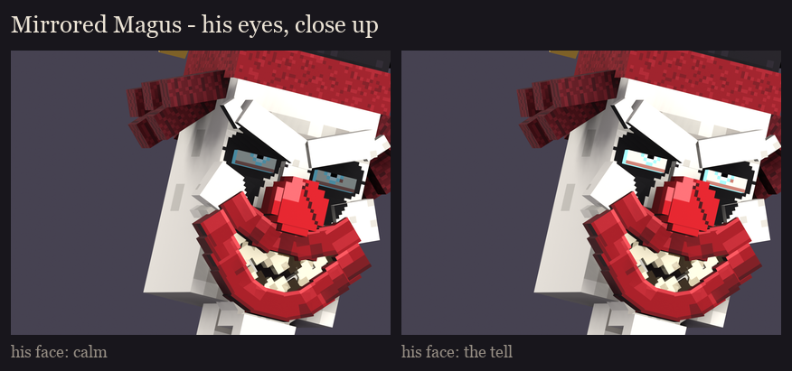
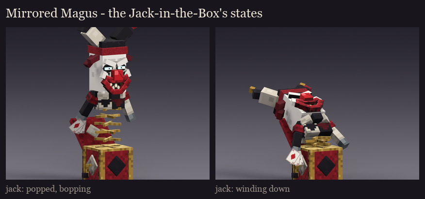
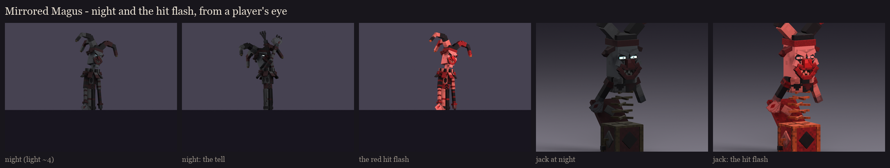

# The Mirrored Magus redesign, session 6: variants and readability

His variants are **BetterModel per-bone tints**: a colour multiplied into the texture, no texture swap. The painted
textures are the brightest they get, and each tint dims or colours them.

## His states

| State | When | Bones | Tint (RGB) |
|---|---|---|---|
| calm | the fight, and every decoy | `glow_eyes` | 120, 132, 142: the cold stare, dimmed |
| tell | the prism burst's warning and the jacks' finger-snap | `glow_eyes` | 255, 255, 255: the eyes flare to full |
| shatter | a decoy struck, just before it breaks apart | every bone | 170, 225, 255: an icy mirror flash |
| dead | as he falls | `glow_eyes` | 40, 44, 48: out |

**The decoys look exactly like him.** They wear the calm tint and the same rig, because the mechanic depends on it.
Only the sparkle particles the fight code trails behind the real Magus tell them apart, and the jacks give no hint
(the user, 2026-10-13).

The calm tint is dimmed (rather than the full glow) so the tell's flare is plain to see, at night too.

## The Jack-in-the-Box's states

| State | When | Bones | Tint (RGB) |
|---|---|---|---|
| popped | awake, bopping and throwing | `glow_eyes` | 255, 255, 255: wide awake |
| winding | the 15 s wind-down, as the spring sags | `glow_eyes` | 96, 104, 112: the lights going out |

**In the fight** (session 8):
- **Magus tints:** the calm tint goes on at spawn, for him and each decoy. The tell flares the eyes for the prism's
  warning and the finger-snap that summons jacks. A struck decoy gets the shatter tint for a few ticks before its
  break-apart animation. The death dims the eyes.
- **Jack tints:** each jack starts popped and dims as it winds down.
- **Re-tint after a hit flash:** as for The Unbound and the Night Matriarch, each tint is applied again about 12 ticks
  after it changes. The hit flash restores a bone's previous tint when it ends, so a change landing during a flash would
  otherwise be lost.

## Readability

- **At night** (light level about 4), he dims to a tall dark silhouette: the hat's three points, the ruff, the long
  striped legs. His full-bright eyes stay lit, and the flare during the tell is visible from a player's eye.
- **The jacks at night:** their eyes stay lit above a dark box and spring. Their white faces still read as faces.
- **Under the hit flash**, he and the jacks redden all over, and the eyes stay the brightest thing on them.
- **What dims at night:** his red nose, lips and cards aren't full-bright. The silhouette and the eyes carry him in the
  dark.

Regenerate with `python tools/art/bosses/magus_s6.py` (after `magus_s5.py`).
