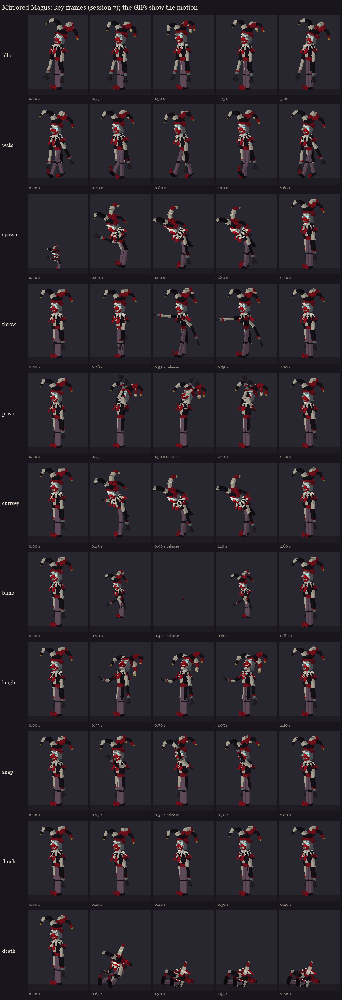
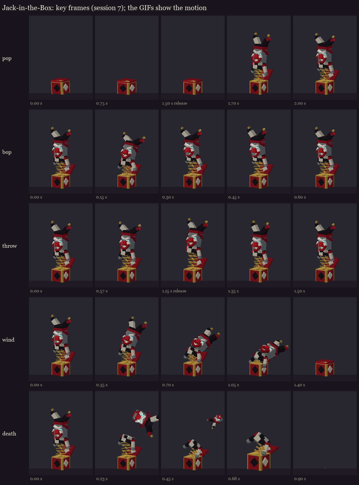

# The Mirrored Magus redesign, session 7: animation

Eleven clips for the Magus on the session 5 rig, and five for the Jack-in-the-Box on its own rig.
- **Built from poses:** his clips are made from session 2's key poses, as each bone's turn away from rest. The hips
  sink with a position key wherever a pose sits him lower (the curtsey, the blink's fold, the death).
- **The hat:** its three floppy points flop and swing through his idle, walk and flinch, each segment lagging the one
  before it.
- **Releases:** each action clip has a release time (bold below). Session 8 starts the clip so the release lands on the
  server's real moment. Animation is cosmetic, and every hit and telegraph comes from the server.

## The Magus (`occultech_mirrored_magus_rig`)

| Clip | Length | Plays | What happens |
|---|---|---|---|
| idle | 3.0 s | loop | hunched, swaying from the hips, his head tilting side to side, the hat's points flopping |
| walk | 1.6 s | loop | a long-legged stalk: high knees, the arms swinging loose, a bob on each step |
| spawn | 2.4 s | once | unfolding out of himself (the blink's fold), rising into a deep curtsey, then up |
| throw | 1.2 s | once | the card fan: the arm drawn back, flung out **at 0.55 s** (the cards leave his palm), the follow-through |
| prism | 2.2 s | once | his arms rise with the cards overhead, trembling through the 30-tick warning; the burst **at 1.5 s** |
| curtsey | 1.8 s | once | conjuring the decoys: the bow, the decoys appear **at 0.9 s** |
| blink | 0.8 s | once | folding into himself and shrinking to nothing; the teleport **at 0.4 s**, unfolding where he lands |
| laugh | 1.4 s | once | a decoy struck: his head thrown back, shaking with the laugh |
| snap | 1.0 s | once | the jacks' summons: his left hand raised, the snap **at 0.5 s** |
| flinch | 0.4 s | once | hit: a jolt, layered over whatever he's doing |
| death | 2.6 s | hold | the strings cut: he crumples and sits slumped, his head lolling, the hat's points flopped down |

The throw, snap and flinch override only the bones they move, so the idle or walk goes on underneath.

## The Jack-in-the-Box (`occultech_mirrored_magus_jack`)

Its own model, built at half size and set on the ground: about 100 cubes on 12 bones, painted with the Magus's
painters, with a hitbox round the whole jack.
- **The spring:** the clown's body is a sibling of the spring, not its child. Each clip scales the spring in y and
  moves the body with its top, so the clown bounces without being squashed with it.

| Clip | Length | Plays | What happens |
|---|---|---|---|
| pop | 2.0 s | once | the box shut, rattling, its crank turning through the 1.5 s warning; the lid flies open **at 1.5 s** and the clown shoots up past full stretch, wobbling to a stop |
| bop | 0.6 s | loop | the spring squashing and stretching, the clown nodding, the hat flopping, the arms bouncing |
| throw | 1.5 s | once | three bops winding up, a big stretch back, the flick **at 1.15 s** (the card leaves his hand) |
| wind | 1.4 s | hold | the wind-down: the spring sags, the clown droops into the box, the lid slams shut |
| death | 0.9 s | hold | broken: the head pops off the spring and spins away, the spring goes limp, the box bursts |

The GIFs in `magus/gifs/` and `jack/gifs/` show each clip moving (flat zone colours, the eyes at full glow).
`clips.json` lists every clip's length, mode, bone count and release time.

## For the fight code (session 8)
- **Starting clips on time:** start each action clip early by its release time.
  - **The card fan:** start `throw` 11 ticks before the cards are thrown.
  - **The prism:** start `prism` as the 30-tick warning begins.
  - **The decoys:** start `curtsey` 18 ticks before they spawn.
  - **The blink:** start `blink` 8 ticks before the teleport.
  - **The jacks:** start `snap` 10 ticks before they appear.
- **A struck decoy:** it plays the shatter tint (session 6), then breaks apart. The real Magus plays `laugh`.
- **Each jack's life:**
  - **Spawn:** it plays `pop` when it appears, and its 1.5 s crank is the telegraph.
  - **Idle:** after the pop it loops `bop`.
  - **Attacks:** it plays `throw` for each card, starting 23 ticks before the card leaves.
  - **The end:** it plays `wind` at the end of its 15 s, or `death` when broken, and its entity is removed when the
    clip ends.

Regenerate with `python tools/art/bosses/magus_s7.py` (after `magus_s5.py`). It writes both rigs here and copies them
to the test server's BetterModel models.
