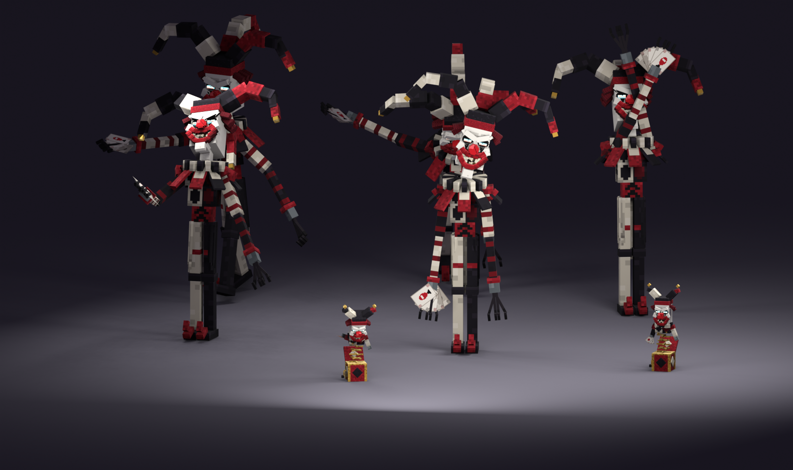

# The Masquerade (was the Mirrored Magus) redesign, session 8: shipped

The horror clown magician is the real fight now, renamed **Masquerade** (2026-10-14; the id `MIRRORED_MAGUS`
became `MASQUERADE`, and `core/BossIds` maps the old id in saved fights, win counts and showcase buttons), with his reflections and the Jack-in-the-Boxes. The models are
generated by `python tools/art/bosses/magus_ship.py` (after the session scripts, through `magus_s7.py`).

`hero_scene.png` is made by `python tools/art/bosses/magus_hero.py`. The real Magus stands in front, staring out, with
his reflections round him in other poses and two jacks popped up on the floor.

## No flickering faces

The ship script refuses to ship a model in which two faces share a plane, since they z-fight in game.
- **The Magus:** the teeth's pointed tips shared their bodies' front and back faces.
- **The jack:** the spring's coils touched each other and the chest.
- **The fix:** the Witch Coven's resolver now runs in the rig's finish step (`magus_s2.finish`). The smaller part of
  each clash moves a fraction of a texel off the plane: 76 parts on the Magus and 40 on the jack. The jack is resolved
  at its shipped half size, so its nudges survive the shrink. Sessions 2 to 7 were regenerated with it.

## Shipped

- **The models:**
  - `src/main/models/occultech_masquerade.bbmodel`: the session 7 rig with its painted atlas, the hitbox and the
    eleven clips.
  - `src/main/models/occultech_masquerade_jack.bbmodel`: the Jack-in-the-Box, with the clips `rise`, `idle`,
    `throw`, `hit`, `wind` and `shatter`. The names are the ones the engine plays on a fight object's model: it plays
    `rise` when the object appears, `hit` per hit and `shatter` when it breaks, and `idle` is BetterModel's default
    loop.
  - Both are installed into BetterModel's models folder at startup and merged into the Occultech resource pack.
- **Mythic:**
  - `src/main/mythic/Mobs/Masquerade.yml`: two carriers, both pillagers (see the fixes below). `OCCULTECH_MASQUERADE` is him;
    `OCCULTECH_MASQUERADE_DECOY` is his reflections, with the same model and 1 health.
  - `Skills/Masquerade.yml`: 13 cosmetic skills (`tools/art/bosses/magus_mythic_skills.py`); take 3 added
    `UNTINT`, `EYES_TELL` and `EYES_CALM`.
- **The card:** `occultech:magus_card`, a resource-pack item model (`tools/art/bosses/magus_fx_items.py`): a white
  playing card with a red diamond, carried by every thrown card.
- **The pack:** sha1 `57abff76` (built with the Elder of Ash, and carrying take 3's models; was `c309f4de`).
  BetterModel's output for the shipped models is merged in, and the jar carries the same zip.

## Fixes after the first in-game test (2026-10-14)

The user's first fight: the model didn't properly replace the carrier, he moved slowly for his size, never looked at
the player, the cards didn't leave his hand, and the Jack-in-the-Boxes showed only the box and spring.
- **The carrier is a pillager.** An invisible illusioner still draws its mirror images, which showed through the model;
  an invisible pillager draws nothing. Without Mythic he is still an illusioner.
- **He stalks and stares.** The fight moves him and every reflection: it closes in past 13 blocks, backs off inside 6,
  and in between drifts sideways round its target, standing still for every gesture. Every tick it turns his body and
  head to the fighter he stalks (the model's `hi_head` bone follows the carrier's head). His speed is 0.3, and the walk
  clip's cycle is now 1.6 s, so his stride keeps up.
- **The cards leave his hand:** from where the throw pose flings it, turned with his body. The jack's card leaves the
  jack's hand.
- **The jack's clown shows.** It was hidden in the shut box by a near-zero scale, which BetterModel left in place, so
  the clown never appeared. It now waits below the floor, under the shut box, and shoots up on the pop; the wind-down
  drops it back below. No clip scales anything below a third any more: his blink shrinks to a third, and the thrown
  cards in his palm to a third.

## Take 3: fixes (2026-10-14)

- **He could stay red after a hit.** BetterModel's hit flash tints every bone red for 10 ticks, then restores each
  bone's previous tint. A tint that lands during the flash (his eyes flaring for the prism, the snap or the laugh)
  records the red as that previous tint, so he stayed red. Now:
  - a clean tint runs once the flash is over: every bone back to untinted (`UNTINT`), then his eyes, flared or calm
    (`EYES_TELL` or `EYES_CALM`), once, with no delayed re-tint that could land on a new flare;
  - it waits until no flash can still be running (the newest hit's clean follows it), and it also runs every 3 s as a
    safety net.
- **He could walk round shrunk after a blink.** The blink shrank him to a third, and a blink cut off (by the teleport,
  or by another clip) left the scale on his bones. Now:
  - the blink uses no scale at all: he folds into a crouch and sinks into the floor as his head turns all the way
    round, and rises back out of it where he lands;
  - his `idle` and `walk` loops key every bone and channel that any other clip moves, at rest. A clip that is cut off
    can no longer leave any bone posed; the jack's `idle` does the same.
- **Tested:** the self-test passes with them (562/0, run with the Elder of Ash's ship). The hit flash and the blink
  only show in a real fight, so they're in the list below.

## How the fight uses them (Masquerade.java)

**The body:** with the Mythic body, the carrier stays unscaled and holds nothing; the model draws him about 6.5 blocks
tall with his cards. Without Mythic, the fight plays on a scale-1.2 illusioner holding a paper card.
Either way he moves at 0.3 (a long stride).

**His reflections look exactly like him.**
- **One look from the first frame:** `BossFight.spawnLookalike` spawns each reflection as an extra mob on the `_DECOY`
  carrier. A `_DECOY` carrier wears its boss's own model, put on at once (`MythicBody.modelFor`), so no frame shows
  one different.
- **Every gesture together:** each of his gestures plays on every reflection at the same moment, so only the sparkle
  trail tells the real one apart.
- **They never attack:** reflections have no target, so they never cast or throw.

**The fixes from the rework plan (boss-rework-plan.md):**
1. **Atomic look:** reflections get his model and his calm tint as they spawn, and copy every gesture with him.
2. **No rig left behind:** a struck reflection flashes icy (the shatter tint) and is removed 3 ticks later, before
   the game's death fall can show its model.
3. **A wind-up before the fan:** the throw clip starts 12 ticks before the cards fly, so you can read it.
4. **Casting first:** a prism, a bow, a snap or a blink in progress holds the next fan back, and the prism still marks
   its target when the warning starts.

**The arrows are now cards.** Every 3 s he throws a fan of three cards, 10 degrees apart, from his hand where the
throw pose flings it (2.2 blocks to his right, 3.9 up, 1.7 ahead). They fly straight at 1.3
blocks a tick, slow enough to sidestep. Each card is "Card fan", 20 damage, telegraphed by the wind-up. It was 16; the
balance bands put a telegraphed tier-1 projectile at 12-30%, and 16 graded 10%.

**The Jack-in-the-Boxes.**
- **The snap:** every 20 s (the first at 10 s) he snaps his fingers. 12 ticks later the boxes appear: two, plus one per
  extra fighter, at most four. Each box is placed at least 6 blocks from every player and 3 from the other boxes,
  facing the nearest player.
- **The warning:** each box cranks for 1.5 s to a rising music-box tune, with notes above it, then pops open.
- **The throw:** every 2.5 s a jack throws one card at the nearest fighter it can see. It bops three times first, and
  the card leaves 23 ticks after the throw clip starts. The card is "Jack card", 8 damage, an add's attack, and flies
  at 0.7 blocks a tick.
- **The end:**
  - **Broken:** 3 hits break a jack; it bursts in confetti with a honk, and the `shatter` clip plays.
  - **Winding down:** after 15 s it winds down: its eyes dim, the lid slams and it goes.
  - **His death:** when he dies, every jack winds down.
- **No hint:** breaking a jack tells you nothing about which Magus is real (decided 2026-10-13).
- **Without BetterModel:** a jack is a jack-o'-lantern display with the same hitbox and cards.

| Server event | Mythic skill | What you see |
|---|---|---|
| spawn, and each reflection's spawn | `STATE_CALM` | the calm eye tint |
| every 3 s: the fan (with every reflection) | `THROW` | the coiled wind-up, the whip; the cards leave on the release |
| every 10 s: the prism's warning (with every reflection) | `PRISM` (target: the player) | he rises, arms up with the cards, trembling; the eyes flare; the burst at 1.5 s |
| every 15 s: the reflections (with every reflection) | `CURTSEY` | the too-deep bow, his face staring up; the reflections appear 20 ticks in |
| the blink (him, and a reflection he swaps with) | `BLINK` | the fold, the head turning all the way round; he vanishes 9 ticks in |
| a reflection struck | `LAUGH` (target: the player) | he convulses with laughter, then blinks |
| the struck reflection | `SHATTER` | an icy flash over every bone, then it is gone |
| every 20 s: the jacks (with every reflection) | `SNAP` | the hand rising, the snap jolting his body; the eyes flare |
| he's hit | `FLINCH` | a violent jerk (not during a gesture) |
| death | `DEATH` (mob file) | the strings cut, his eyes go out; the model hands over to the stand-in so the whole clip plays |

## Tests

- **Self-test with Mythic:** 557 passed, 0 failed (server b).
  - **The first run:** one failure, the balance bands for the cards. Fixed as described above.
  - **New checks:** the Magus has one BetterModel tracker, his model has its hitbox, his carrier stays unscaled and
    holds nothing, and the jack model is loaded.
- **Unit tests:** pass.
- **Load:** both models loaded with the other eight, and the Mythic pack installed the two carriers and the skills.
- **Not covered:** the self-test runs the Magus for 3 s, so the reflections (at 5 s) and the jacks (at 10 s) are only
  checked in a real fight.

## In game

1. Push the pack repository (`occultech_texture_pack_v1.0`) and the addon repository.
2. Restart your server with the run-server script, so it gets the new jar (pack sha1 `57abff76`).
3. Summon the Masquerade at a tier 1 circle, or use `/occultech showcase`.

Please check:
- **His look and motion:** the idle sway and head snaps, the limping walk.
- **The fan:** the wind-up, then three cards you can sidestep.
- **The reflections:** at 5 s, they look and move exactly like him; only the sparkle gives him away. A struck one
  flashes and shatters, and he laughs and blinks.
- **The jacks:** at 10 s, the crank and tune, the pop, the bop, the throw; break one in 3 hits, or watch one wind down
  after 15 s.
- **Take 3:** he never stays red after being hit, even mid-flare; he never walks round shrunk or posed after a blink.
