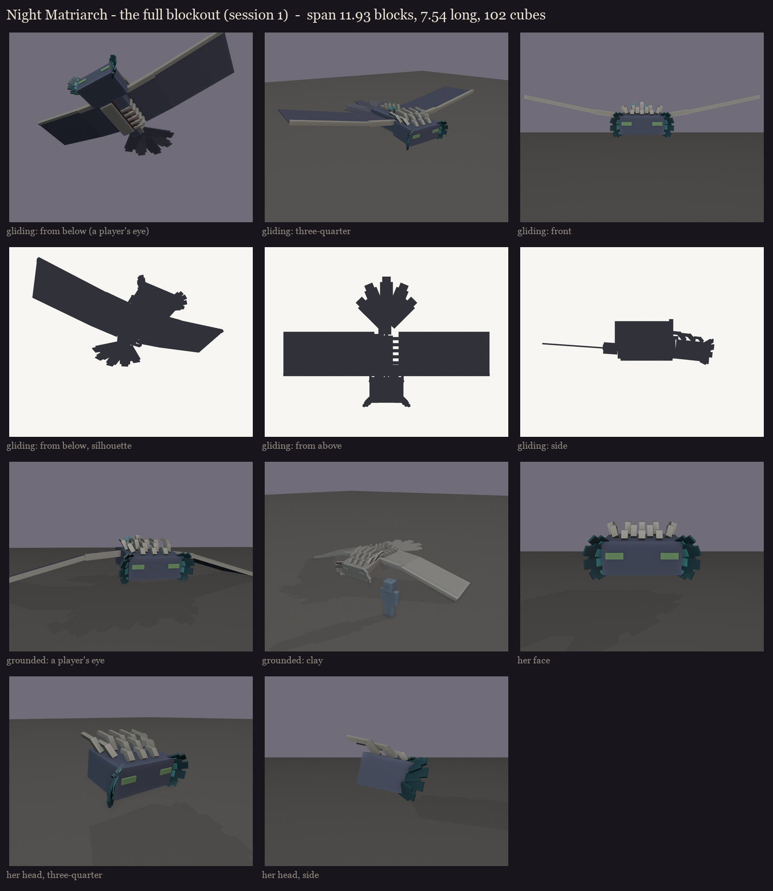

# The Night Matriarch redesign, session 1: the full blockout

The user skipped the face study (2026-10-12) and asked for these changes to take 2 of the Phantom Queen:
1. the sculk is mostly texture;
2. the tendrils round her head look like the warden's horns, smaller and many, like feathers round a bird's face;
3. the bones on her head stand in several rows and arch backwards;
4. a less scary face, close to vanilla's phantom;
5. the torn wings are texture, not missing blocks.

- **Size:** vanilla's phantom model at 4.5x, about 12 blocks across the wings and 7.5 long, 102 cubes. Her right side
  keeps its hide; her left flank is rotted open to the ribs. In the texture, half her head becomes bare skull.
- **Sculk:** painted in session 5. Only three small sensor tendrils with glowing tips stay modelled, on her back.
- **Face:** vanilla's phantom head with its long green eyes at the corners, with no jaw and no fangs.
- **The ruff:** four small warden-horn tendrils on each side of her face.
  - **Shape:** broad and tapering, overlapping like an owl's facial feathers.
  - **Fan:** spread round the face from the brow to the chin, and swept back.
  - **Glow:** each glows in its inner part, like the warden's.
- **The crown:** three staggered rows of bone from her brow back over her head (3, 4, then 5), longer row by row.
  Each bone leans back from its base and bends further back at its tip, and the outer ones lean out.
- **The wings:** vanilla's two panels, whole, with a bone spar along each leading edge. The tears, holes and bare
  finger bones are painted as cut-outs in the texture (like the chains on The Unbound).
- **The owl's tail:** five broad rounded feathers fanned behind a short tail with bare vertebrae.

Every turned part is turned in Blockbench's free steps (22.5 or 45 degrees), one axis per bone, so nothing costs extra
displays.

Model: `occultech_night_matriarch_blockout.bbmodel` (the gliding pose). Regenerate with
`python tools/art/bosses/matriarch_s1.py`.
