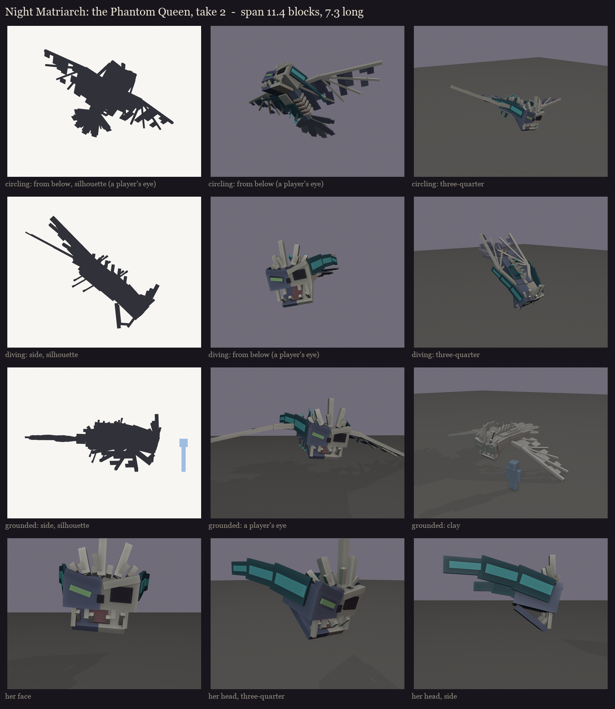

# The Night Matriarch redesign, session 1 step 2: the Phantom Queen, take 2

The user picked B, the Phantom Queen, over C, and asked for far more character and story (2026-10-12):
1. incredibly large;
2. visibly injured, with torn wings and bones showing;
3. half her flesh gone: a zombified phantom;
4. sculk growing over her, with tendrils; bones breaking out of her head like a crown; two giant warden-style sculk
   horns flowing back like feathers;
5. an owl's tail;
6. a creepier face.

- **Size:** vanilla's phantom model at 4.5x, a wingspan of 11.4 blocks and 7.3 blocks long. She circles 9 blocks up.
- **Injured:**
  - **Wings:** ragged trailing edges, holes, and whole strips gone down to the finger bones.
  - **Left flank:** torn open to the ribs.
- **Zombified:**
  - **Body:** her right side keeps its blue phantom hide; on her left the flesh has rotted away to the ribcage.
  - **Head:** half of it is bare skull.
  - **Tail:** its base shows bare vertebrae.
- **Sculk:**
  - **Growth:** patches on her back, her belly, a flank and her right wing, with veins along the wing. Sensor
    tendrils with glowing tips sprout from her back and hang from her belly, so players see them from below.
  - **Crown:** jagged bone shards break out of her brow, uneven, leaning back and out.
  - **Horns:** two warden-style horns, each three flat sculk blades, sweep back from her temples along her head and
    past it, curling in at the ends like feathers. A glowing core runs down each.
- **Owl's tail:** a broad fan of seven rounded feathers, one broken off to its bare shaft.
- **Face:**
  - a scowling brow in a V;
  - the phantom's long green eye on her flesh side, and a deep empty socket on her skull side with a sculk light far
    inside;
  - a hanging jaw with a tongue and long, uneven fangs.

Colours here are blockout zones only: blue hide, bone, red-brown rotten flesh, dark sculk with cyan glow, and phantom
green for the eye. The texture comes in session 5.

Regenerate with `python tools/art/bosses/matriarch_queen.py`.
