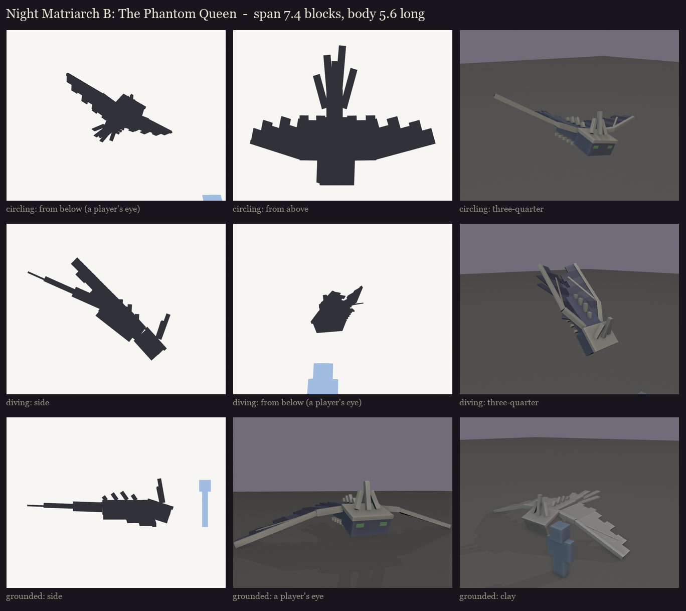
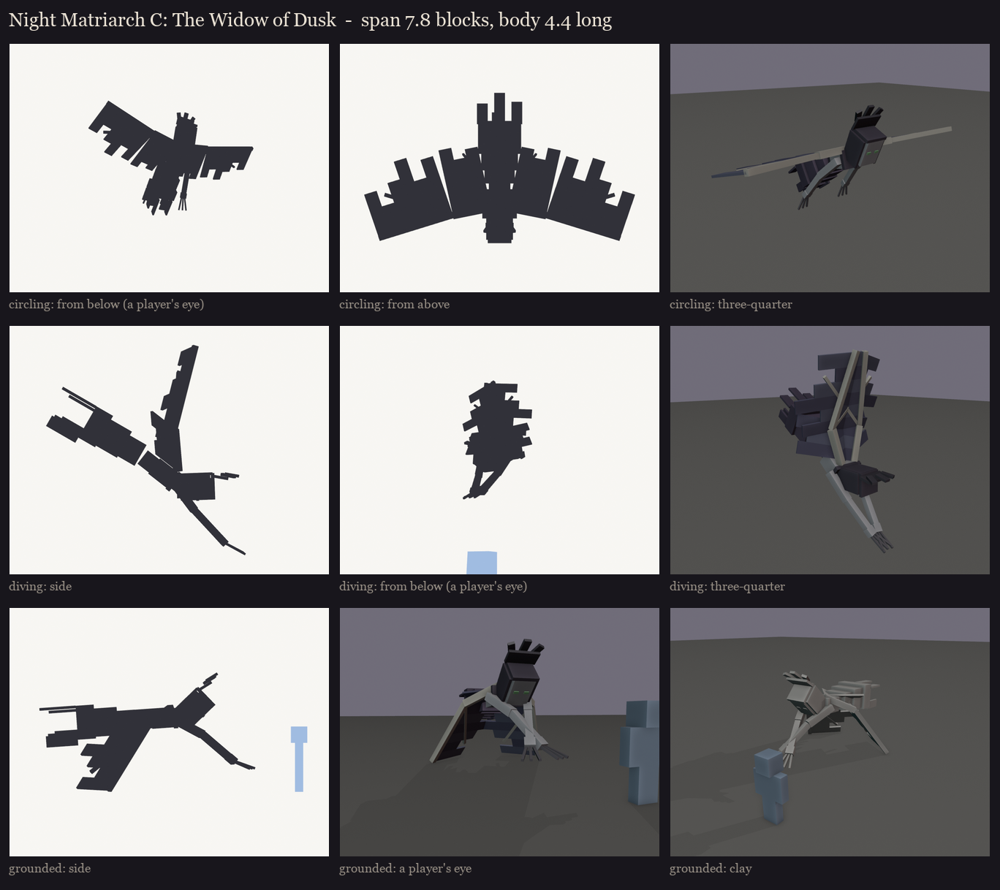

# The Night Matriarch redesign, session 1: first silhouette check

The user asked to see directions B and C separately (2026-10-12). Both are cuboid blockouts, shown in the three
moments her fight needs. Her fight code is unchanged (`NightMatriarch.java`):

- **Circling:** she circles above the arena and rakes whoever she sweeps past. Here she's 5 blocks up and banking,
  seen from a player's eye below, from above, and in three-quarter view.
- **Diving:** a dark circle marks a player's spot for 1.5 s, then she dives onto it. Here she's mid-dive, head down,
  with her wings swept back.
- **Grounded:** she lies stunned on the floor for 1.5 s, the melee window. Her wings are collapsed, low enough to keep
  the floor's warning ring in sight.

The blue figure is a player (1.8 blocks). Grey and violet are blockout colours only, not the palette.

## B: the Phantom Queen

Vanilla's phantom (its model at 3x) made regal:
- the long flat body, the two-part wings and the tail;
- a circlet of bone with three swept-back tines;
- a spine of bone, and ribs under the belly;
- bone spars along the wings' leading edges, and torn trailing edges;
- a train of four tattered ribbons behind the tail.

Wingspan 7.4 blocks, 5.6 long.

## C: the Widow of Dusk

A gaunt woman in mourning, carried by huge phantom wings growing from her shoulder blades:
- a long illager-length head under a veil, with a tall mantilla comb standing up behind it;
- long thin arms ending in claws;
- a ragged gown in place of legs.

She flies prone, dives head-first with her claws out, and collapses face down with her wings fallen over her.
Wingspan 7.8 blocks, 4.4 long.

Regenerate with `python tools/art/bosses/matriarch_silhouettes.py`.
