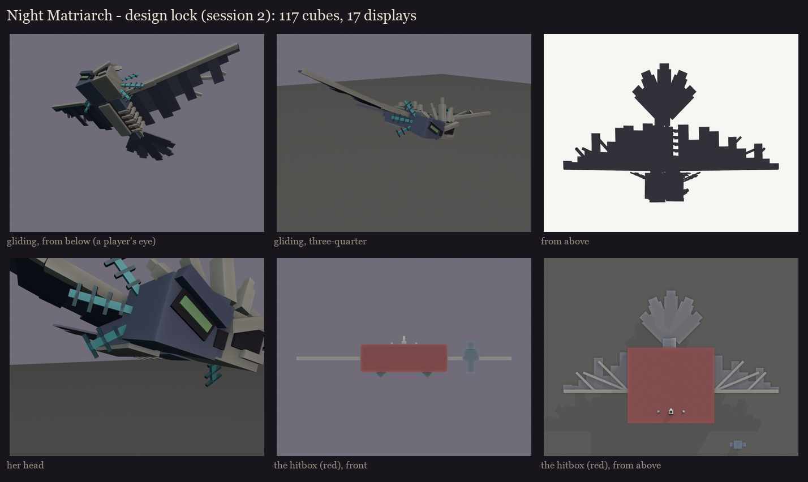
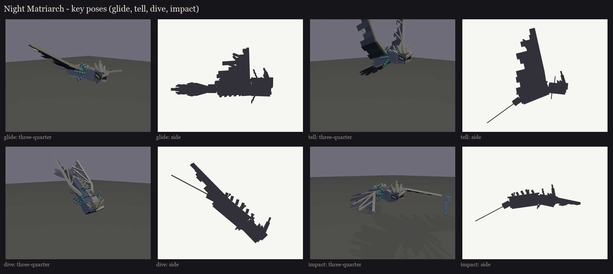
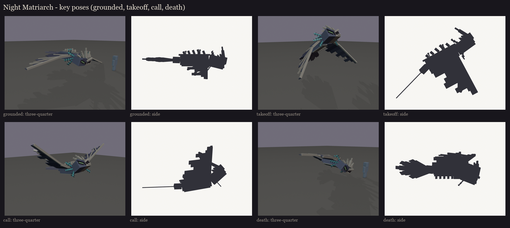

# The Night Matriarch redesign, session 2: design lock

The approved blockout ([../s1_blockout](../s1_blockout/README.md), take 2) is rebuilt as a rig and locked: every cube is
snapped to whole texels, the hitbox is set, and she's posed for the fight's moments.

## Size and hitbox

- **Model:** about 12 blocks across the wings and 7.4 long. Her body is the size of vanilla's phantom at 4.5x.
- **Hitbox:** one invisible `ob_hitbox` bone, 4.9 x 1.6 x 4.2 blocks. It covers her body, head and the inner wing
  panels, but not the outer wings, the tail, the crown or the gills, so nothing thin and far out is a free target.

## Bones (BetterModel names)

**The bones:**
- `body`: the hide, the open ribcage, the spine and the sensor tendrils' stalks;
- `hi_head`: the head (half hide, half sunken skull, torn hide over the split, the brows, the empty socket), which
  turns with its children;
- the crown, on two bones, `crown_225` and `crown_450`, holding the shards raked back 22.5 or 45 degrees. Inside its
  bone a shard only leans out, so no cube is turned on two axes.
- `wing_left` and `wing_right`, the inner panel; `wing_left_tip` and `wing_right_tip`, the outer panel. These are take
  2's torn shape. The finger bones are snapped to 22.5 and 45 degrees.
- `tail`: the short tail and its owl's fan.

**Glow bones, drawn full-bright:**
- `glow_eye`: her green eye, and the sculk light in the empty socket;
- `glow_tendrils`: the tips of the sensor tendrils on her back;
- `glow_gill_left_0` to `_2` and `glow_gill_right_0` to `_2`: one bone per gill, so each can flick on its own.

**Counts:** 117 cubes and 17 bones with geometry, so 17 displays. Every turned cube is turned once, by 22.5 or 45
degrees, so none costs an extra display. Full list: [parts.md](parts.md).

**The gills** are each one flat plane, like vanilla's axolotl gills and warden horns. Their fronds are cut out of the
texture in session 5. The renders here draw the frond (a glowing stalk with filaments) in place of the plane. **The
wings' tears** and holes are cut-outs in the texture too, and **the sculk** is painted.

## Take 2 of the face and crown

After session 4 the user found the face a little goofy: the brows made her look sad, not menacing. They asked for the
scarier face and the real crown of the first take-2 study.
- **The brows:** they were tilted the wrong way, inner ends up, which reads as sad. Now they press down in a V, inner
  ends low.
- **The eye:** the phantom's green eye slants the same way, sunk in a dark pit.
- **The skull side:** a bigger, deeper empty socket. She has a nose pit too.
- **The crown:** jagged bone shards broken out through her brow, back to the study's crown.
  - **Front row:** the tallest in the middle, fanning out to both sides, and raked back. The big ones have a narrower
    point and a spur split off the base.
  - **Behind:** a second, lower row.
- **Still no mouth.**

## Key poses

The fight's moments, posed from the rig. They are design silhouettes, not animation.

- **Glide:** circling over the arena, banking.
- **The dive's tell** (the 1.5 s warning): she rears with her wings raised high, her head down at her target, her
  gills flared.
- **The dive:** nose down, wings swept back, gills streaming.
- **The impact:** slammed into the floor, wings flung forward.
- **Grounded** (stunned, 1.5 s, the melee window): sprawled flat, wings limp, gills drooping.
- **Takeoff:** a great downbeat, nose up.
- **Calling the swarm:** head thrown up, wings spread wide, gills flared.
- **Death:** crashed on her side, one wing folded over her like a shroud.

Flapping, banking turns and the gills' flicking are left for the animation session (7).

Regenerate with `python tools/art/bosses/matriarch_s2.py`. The editable model with its hitbox is
`occultech_night_matriarch_blockout.bbmodel`.
