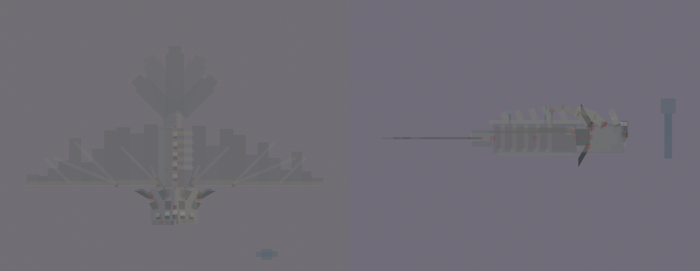

# The Night Matriarch redesign, session 3: rig and pose test

The session 2 rig, checked and made loadable in game with a flat colour per material. Her eye, the sculk glow and
the gills are full-bright.

## Checks

- **Tags:** only the intended bones carry a BetterModel tag. That's `hi_head`, `ob_hitbox`, and the glow bones:
  `glow_eye`, `glow_tendrils` and the six `glow_gill_*`. None are missing and there are no strays.
- **Displays:** 19, one per bone. No cube is turned in a way that costs an extra display. 113 cubes.
- **Pivots:** see [pivots.md](pivots.md) and the markers below (red, from above and from the side).
  - **Joints:** every moving bone pivots in its joint: the head at the neck, each wing at the shoulder and the elbow,
    the tail at its root, and each gill at its base.
  - **Not joints:** the four crown bones pivot on top of her head, away from their own horns. That's intended: they
    never move on their own. Each one only holds horn segments at its own rake, and turns with the head.



## In game

The review model `occultech_night_matriarch_rig` loaded on the second test server with the shipped models and no
warnings (8 models). It is also in your server's BetterModel models folder. It's for review only and never shipped.

```
/bm reload
/bm test occultech_night_matriarch_rig glide
/bm test occultech_night_matriarch_rig tell
/bm test occultech_night_matriarch_rig dive
/bm test occultech_night_matriarch_rig impact
/bm test occultech_night_matriarch_rig grounded
/bm test occultech_night_matriarch_rig takeoff
/bm test occultech_night_matriarch_rig call
/bm test occultech_night_matriarch_rig death
```

`/bm test` puts her at your feet. She's 12 blocks across, so step back to see her whole. The poses are held, not
animated: the motion is session 7.

Next, session 4: UV and material blocking. That includes laying out the gills' and wings' cut-outs.

Regenerate with `python tools/art/bosses/matriarch_s3.py` (after `matriarch_s2.py`).
