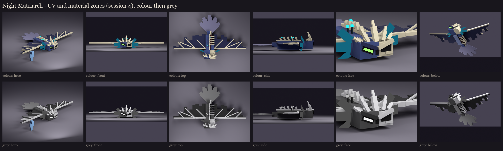

# The Night Matriarch redesign, session 4: UV and material blocking

Every visible face of the session 3 rig is mapped at one texel per model unit (16 per block, the vanilla density) into
one 256x256 atlas.
- **Atlas:** 633 islands in 236 rows, 55% filled. Each island has a 1-pixel border against seams.
- **Buried faces:** 39 faces buried inside another cube of the same bone are left out.
- **Shared space:** only the gills share texture space; each left gill uses its right twin's frond, mirrored. She is
  lopsided on purpose: hide on her right, bare bone on her left, and each wing torn its own way. So nothing else is
  shared.

## Material zones

Tied to vanilla's phantom: its blue-grey hide, its paler underside, the dark wing membrane and the green eye.

| Zone | Colour | Where |
|---|---|---|
| hide | 68, 82, 130 | her right side and half her head |
| hide_dark | 38, 44, 80 | the brow |
| belly | 128, 140, 176 | the underside |
| flesh | 74, 30, 38 | rotten, inside the open left flank |
| bone | 206, 198, 172 | the skull, ribs, spine, crown, wing spars and finger bones |
| membrane | 38, 42, 74 | the wings |
| feather | 122, 120, 146 | the owl's tail, paler and greyer than her hide |
| sculk | 16, 46, 58 | the sensor tendrils' stalks |
| hole | 14, 12, 18 | the empty socket |
| eye | 150, 255, 110 | the phantom's green eye (full-bright) |
| sculk_glow | 40, 214, 232 | the tendril tips and the light in the socket (full-bright) |
| gill | 22, 96, 116 | the gill planes (full-bright) |

**The value check:** every pair of neighbouring zones is at least 12 apart in lightness, so she reads in grey too. The
first pass found three pairs too close: feather and hide, hide and membrane, hide and flesh. So the feathers went
paler and greyer, and the membrane and the flesh went darker.

**Take 2 of the face and crown** (after the user's review): a V scowl, the green eye sunk in a dark pit, a deeper
socket, and a crown of jagged shards. Session 2's notes have the details, and sessions 2 to 4 were regenerated.

## Left for painting (session 5)

- **The sculk:** it spreads over her hide, bone and wings in the texture, as the user asked.
- **The tears:** the wings' tears, holes and bare stretches are see-through cut-outs.
- **The gills:** they show as flat teal panels for now; their fronds will be cut out.
- **Her head:** the rot over her head, and the ragged edge where hide meets skull.

The review rig on your server is updated with this atlas: `/bm reload`, then `/bm test occultech_night_matriarch_rig
glide`.

Regenerate with `python tools/art/bosses/matriarch_s4.py` (after `matriarch_s3.py`).
