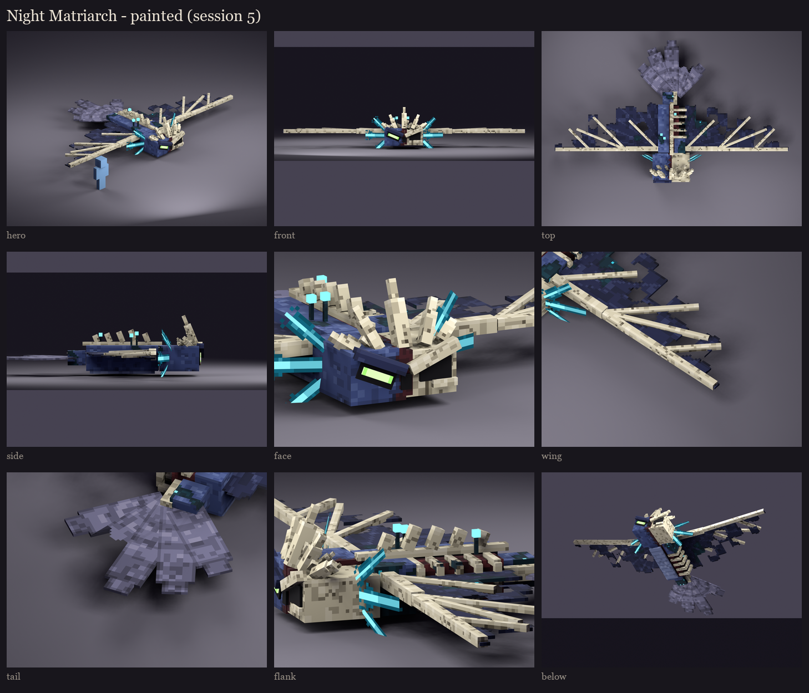

# The Night Matriarch redesign, session 5: texture painting

The session 4 layout painted: the same 256x256 atlas and islands, with fine ramps (close shades, cool darks, lighter
highlights) so the detail stays subtle. The shading is ambient occlusion baked from the real geometry; there's no
painted light direction.



- **Hide:** vanilla's phantom blue-grey, mottled and leathery, with creases and the tops of masses catching the light.
  The underside is paler and banded like the phantom's.
- **The split down her head:** where the hide gives way to bare skull, it is torn, with a ragged dark edge and raw
  flesh along it.
- **Sculk** (the user: mostly texture):
  - **Where:** dark teal blotches spread over her hide and the roots of her wings, flecked with points of cyan light.
    It is heavier on her rotten left side and her back. It creeps onto her skull and ribs only sparingly.
  - **How:** the blotches are drawn from smooth noise in world space, so they run across cube edges instead of
    stopping at them.
- **Bone:** old and yellowed, pitted and cracked, with a suture down her bare forehead.
- **Rotten flesh:** inside the open flank, dark and sinewed, with wet glints between the ribs.
- **Wings:** dark membrane with paler veins fanning from the shoulder.
  - **Tears** (the user: in the texture, not missing blocks): ragged holes and a torn trailing edge, cut out so the
    sky shows through. Where whole stretches are gone, the finger bones are left bare.
  - **Different per side:** each wing is torn its own way.
  - **Lined up:** a tear is placed by world position, so the same hole goes through the top, the bottom and the edges
    of a strip.
- **Owl's tail:** grey feathers with soft, wide bars across them like an owl's, darker at the tips, each feather's
  edge drawn so the fan reads. One feather is broken off partway.
- **Gills:** each plane is cut out into a frond like an axolotl's gill. A glowing cyan stalk runs down the middle,
  with dark sculk filaments fringing both edges, raked back and shorter towards the tip. Each pair shares one frond,
  mirrored.
- **Glow:** the phantom's green eye with a pale core, and the sculk light deep in the empty socket.

**Fixed in this pass:**
- the sculk had blotched the crown and the wing bones like camouflage; it now stays off the crown and the outer
  wings;
- the tail's bars were tight enough to read as a target; they're now soft and wide;
- the gill fronds were thin; they're now denser.

**In game:** the review rig on your server has the painted texture.

```
/bm reload
/bm test occultech_night_matriarch_rig glide
```

Regenerate with `python tools/art/bosses/matriarch_s5.py` (after `matriarch_s4.py`).
