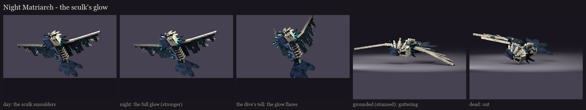
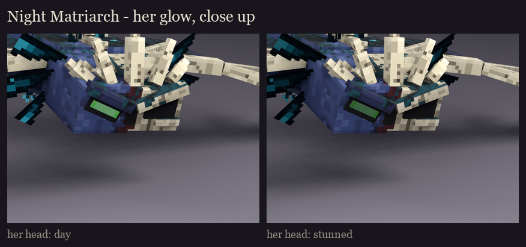
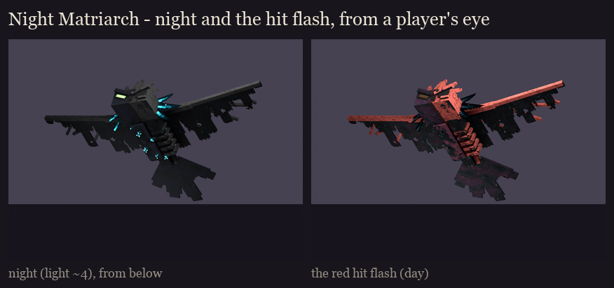

# The Night Matriarch redesign, session 6: variants and readability

Her variants are **the sculk's glow**. Her fight runs by day or by night, and she is stronger at night, so the glow
shows which.
- **How:** in the fight, BetterModel's per-bone tint multiplies a colour into her glow bones: `glow_eye`,
  `glow_tendrils` (the sensor tufts) and the six `glow_gill_*` (the warden horns). There is no texture swap.
- **The scale:** the painted glow is the brightest it gets; each tint dims it.

| State | When | Tint (RGB) |
|---|---|---|
| day | summoned by day | 118, 134, 144: dimmed, the sculk smoulders |
| night | summoned at night (she's stronger) | 255, 255, 255: the full glow |
| tell | the dive's 1.5 s warning, day or night | 255, 255, 255: the glow flares to full, with the tell pose (wings raised, horns flared) |
| grounded | stunned after the impact (the melee window) | 78, 90, 98: the sculk gutters low |
| dead | as she falls | 34, 38, 42: out |

**In the fight** (session 8): the fight code picks day or night as it already does, and plays the matching tint. The
tell flares the glow, and the stun and death dim it.

**Re-tint after a hit flash:** as for The Unbound, each tint is applied again about 12 ticks after it changes. The
hit flash restores a bone's previous tint when it ends, so a change landing during a flash would otherwise be lost.

## Readability

- **At night** (light level about 4), everything but the full-bright glow dims to a dark silhouette. What stays lit:
  her green eye, the warden horns round her head, and the sensor tufts on her back and belly. From below she reads as
  a dark wingspan with a cyan-lit body and a green eye.
- **Under the hit flash**, the whole body reddens. The glow stays the brightest thing on her.
- **The painted cyan specks** in the sculk on her hide aren't on glow bones, so they dim at night with the rest of
  her. The full-bright parts carry her at night.

Regenerate with `python tools/art/bosses/matriarch_s6.py` (after `matriarch_s5.py`).
