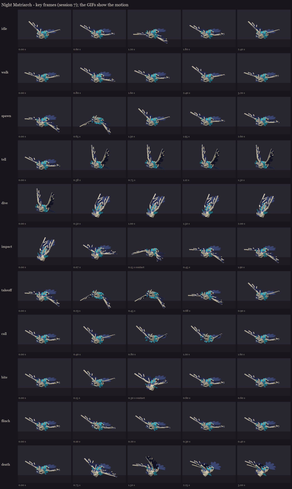

# The Night Matriarch redesign, session 7: animation

Eleven clips on the session 5 rig.
- **Built from poses:** each clip is a few whole poses at key times, made from session 2's pose fields.
- **Keyframes:** each bone's turn away from the rest pose, kept continuous so no bone ever spins the long way round.
- **The bob:** the body rises and falls on the wingbeats, with a position key.
- **The wingbeats:** the wing tips lag the shoulders, so they follow through.
- **The horns:** they flick through every clip, like an axolotl's gills.

| Clip | Length | Plays | What happens |
|---|---|---|---|
| idle | 2.4 s | loop | hovering: slow, deep wingbeats, the body bobbing, the horns waving |
| walk | 3.2 s | loop | flying: a long glide banking side to side, then one great beat |
| spawn | 2.6 s | once | the ritual arrival: up off the ground in two heavy beats into the glide |
| tell | 1.5 s | hold | the dive's warning (30 ticks): she rears, wings raised high, head down at her target, the horns flared, trembling |
| dive | 2.0 s | hold | the dive (up to 40 ticks): wings swept back, nose down, the horns streaming |
| impact | 1.9 s | once | the landing: slammed down **at 0.15 s**, then sprawled and stunned through the 1.5 s melee window, twitching |
| takeoff | 0.9 s | once | up again after the stun: a great downbeat, nose up |
| call | 1.6 s | once | the swarm: head thrown up, wings spread wide, horns flared |
| bite | 0.6 s | once | her rake: the head lunges down, **contact at 0.3 s** |
| flinch | 0.4 s | once | hit: a jolt, layered over whatever she's doing |
| death | 3.0 s | hold | crashing onto her side, one wing folding over her |

The bite, call and flinch override only the bones they move, so the wingbeats go on underneath.



The GIFs in `gifs/` show each clip moving (flat zone colours, the glow at full).

## For the fight code (session 8)

- **Tell:** plays with the dark circle, for its 30 ticks. Then **dive** plays while she flies the dive.
- **Impact:** plays when she lands. Its 0.15 s slam lines up with the impact, and the clip holds her sprawled for the
  30-tick stun. **Takeoff** plays when the stun ends.
- **Bite:** starts about 6 ticks before her rake lands, or plays on the hit itself, since the rake is instant in the
  fight.
- **Call:** plays when the swarm joins.
- **Movement:** **walk** while she flies and **idle** while she hovers.
- **Glow:** the tints from session 6 go with the tell, the stun and death.

**Load test:** the animated rig loaded on the second test server with the shipped models and no warnings (8 models).
It's on your server too:

```
/bm reload
/bm test occultech_night_matriarch_rig walk
/bm test occultech_night_matriarch_rig tell
/bm test occultech_night_matriarch_rig impact
```

Regenerate with `python tools/art/bosses/matriarch_s7.py` (after `matriarch_s5.py`).
