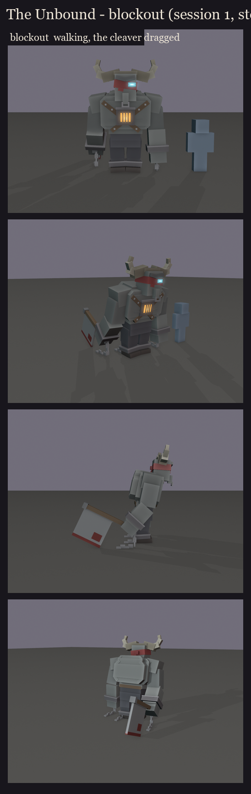
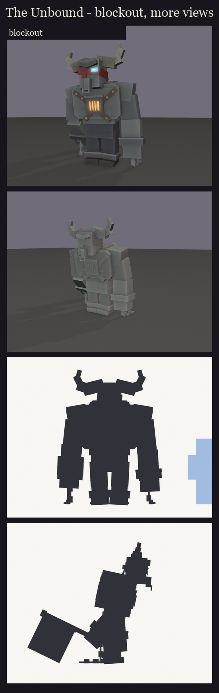

# The Unbound redesign, session 1 step 3: the full blockout

The whole figure from cuboids, built on the locked head and chest ([../s1_face3](../s1_face3/README.md)) and the
take-2 silhouette ([../s1_silhouettes](../s1_silhouettes/README.md)), walking with the cleaver dragged.

**The figure:**
- **Size:** about 3.25 blocks to the top of his head and 3.7 to the horn tips, next to a 1.8-block player.
- **Posture:** a heavy upper body (a deep chest, a broad back and a hump of traps behind the low head) leaning
  12 degrees forward over his hips, so it sits over his legs; the head comes forward under the hump. It started at
  20 degrees, which tipped him over; the back mass is what balances it.
- **Build:** bare grey skin above the waist, the studded straps crossing to the burning chest piece; dark trousers
  and boots.
- **Arms:** long arms hanging past his knees.

**Shackles and chains:** heavy iron shackles on both wrists and both ankles. The wrist chains hang to the ground and
trail behind; the ankle chains drag behind him.

**The cleaver:** the Frenzy Cleaver at his size, its blade about a block across. His right arm reaches back and
drags it upright, the blade's lower corner on the ground and its bloody edge down.

**The head:** as locked: F3's horn boss, buffalo horns, iron nose ring and cyan eye; F2's scowl and slipping
ragged band.

About 128 cubes and 15 bones. Built in the face study's frame and scaled (0.85) to the planned size; session 2
snaps everything to the texel grid.

**For session 2:** final proportions and the texel snap, the hitbox, and the key poses as silhouettes:
- the cleave's wind-up, with the cleaver round his shoulder;
- the sweep;
- calling the thralls;
- devouring a thrall;
- sated, down on one knee;
- the enraged charge;
- death.

Regenerate with `python tools/art/bosses/unbound_s1.py`.
