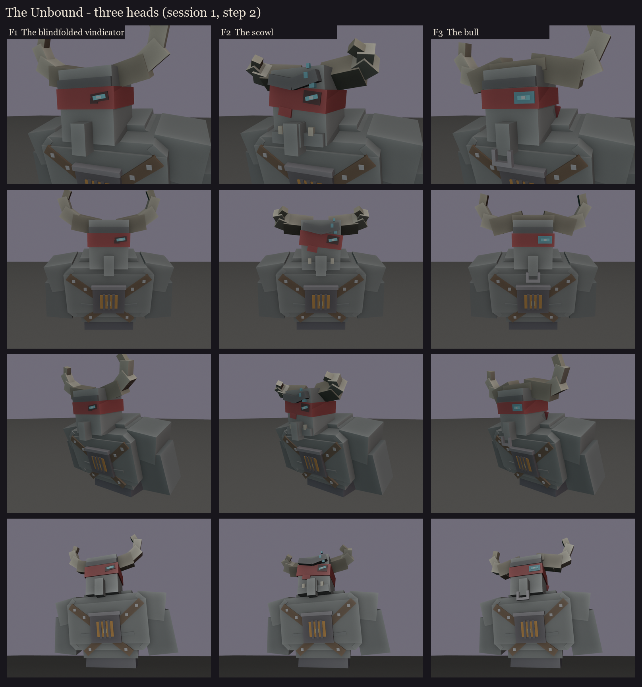

# The Unbound redesign, session 1 step 2: the face study

The silhouettes ([../s1_silhouettes](../s1_silhouettes/README.md), take 2) set the body. This step decides the head.
It's a bust of that body in 3D cuboids: the bare chest, traps and shoulders, the studded straps and the burning chest
piece, with the head sunk low between the traps.

**The head** is vanilla's illager head (8x10x8, the 2x4x2 nose hanging a pixel below the chin; IllagerModel in the
26.2 client) at 1.5x. On every take:
- the red band over the eyes, knotted behind;
- his left eye burning tier 1's spirit cyan through it;
- bull horns.

| | Head | |
|---|---|---|
| F1 | **The blindfolded vindicator** | vanilla's face exactly; a neat band; the eye a cyan slit through a ragged tear; the horns out from the temples, then up, the tips turning a little in. The most clearly a vindicator. |
| F2 | **The scowl** | a heavy brow pushed down into a scowl over the band; a broader nose; a square jaw with an underbite and two small tusks; the band ragged and slipping askew, a torn flap hanging; the eye burning through a scorched hole, cyan wisps rising off it; the horns swept forward like a charging bull's. The angriest. |
| F3 | **The bull** | a heavy horn boss across the top of his skull; wide horns, out, down a little and up, like a buffalo's; an iron ring through the big nose; the band bound tight, its long ends over his shoulder; a soft cyan halo round the eye. The most bull. |

The colours are flat blockout colours. The skin, cloth, horn grain and the glow get painted in session 5, and
the eye glows in game. Parts can be mixed across takes, as with the Coven's faces.

Regenerate with `python tools/art/bosses/unbound_face.py`.
