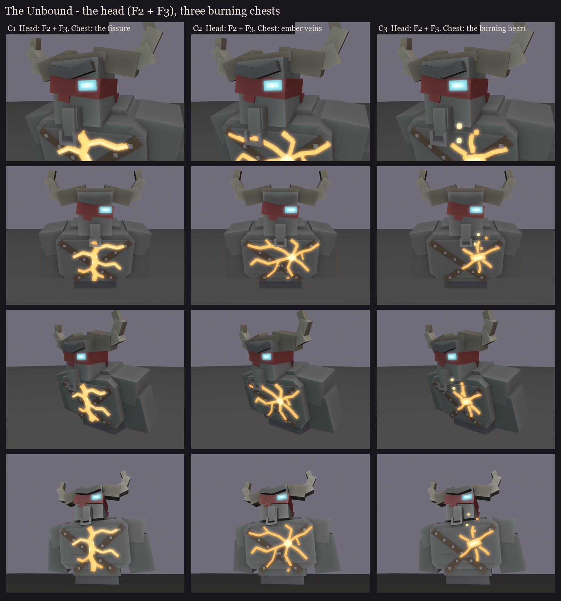

# The Unbound redesign, session 1 step 2 (take 2): the head, and three burning chests

Take 1 ([../s1_face](../s1_face/README.md)) offered three heads on a chest with a furnace plate. The user's picks:
- **F3's horns** (a heavy horn boss across the skull, wide buffalo horns) and **F3's iron nose ring**;
- **F3's eye** (a cyan slit with a soft halo through the weave);
- **F2's face**: the scowling brow and the ragged band slipping askew, **but not** its jaw, underbite and tusks;
- the chest **reworked completely**: he burns from the inside, with no furnace look.

So this is one head, on three ways of burning from the inside. In each, the fire shows through splits in his
skin, and the studded straps still cross his chest.

| | Chest | |
|---|---|---|
| C1 | **The fissure** | one jagged split down his sternum from the collarbones to the stomach, branching across the pecs, brightest in the middle. |
| C2 | **Ember veins** | no single wound: glowing veins spread from his heart over his whole chest towards the shoulders, like lava under cracked rock. The most "burning inside". |
| C3 | **The burning heart** | a short, wide split blazing over his heart (his left chest), short cracks around it, embers drifting out. The most focused. |

The fire and the eye glow here (an unlit pass with a bloom laid over the render); in game they're `glow_` bones,
drawn full-bright. When it's painted (session 5), the skin round the cracks gets a warm spill of light. The stages
as he speeds up can widen and brighten the cracks (more of them shown).

Regenerate with `python tools/art/bosses/unbound_face.py`.
