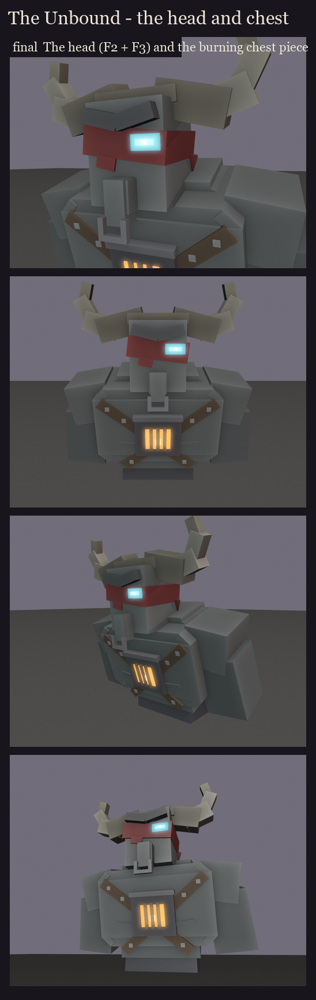

# The Unbound redesign, session 1 step 2 (take 3): the head and chest

Take 2 ([../s1_face2](../s1_face2/README.md)) tried three ways of burning from the inside: a fissure, ember veins and
a burning heart. The user liked none of them and went back to the chest piece of the first design.

The locked head and chest:
- **The head:**
  - F3's horn boss and buffalo horns, F3's iron nose ring, and F3's eye: a cyan slit with a soft halo through the band;
  - F2's scowling brow and its slipping, ragged band;
  - no jaw and no tusks.
- **The chest:** the burning chest piece, a blackened iron plate where the studded straps cross, with fire burning
  behind its grate.

Regenerate with `python tools/art/bosses/unbound_face.py`.
