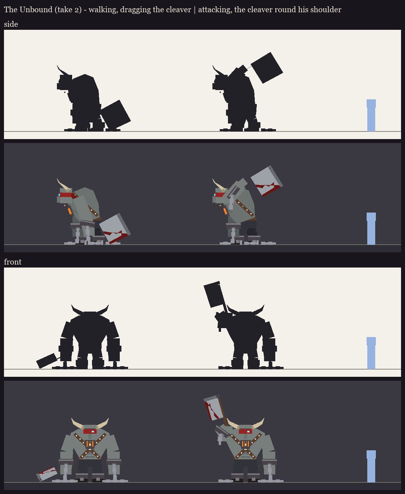

# The Unbound redesign, session 1 step 1: posture silhouettes (take 2)

The direction and the brief are in [../plan.md](../plan.md).

**Take 1** offered three postures: the Charging Bull, the Executioner and the Brute (in git history). The user's
changes:
- no burning tips on the horns;
- clear shackles with chains hanging from them;
- less clothing: trousers only;
- C's hunched side posture, at B's height and width;
- he drags the cleaver behind him when he walks and lifts it round his shoulder to attack;
- the burning eye in tier 1's spirit cyan, through the red cloth;
- a little bigger.

**Take 2** shows one figure in his two poses: walking (the cleaver dragged, its blade on the ground) and attacking
(the cleaver hoisted round his right shoulder for the cleave).
- **Size:** about 3.25 blocks to the top of the head, about 1.8x a player, with the horns above that.
- **Build:** a bare, buff upper body: broad shoulders and lats tapering to the waist, the traps rising round a low
  head, the back hunched forward 20 degrees over the hips. His arms hang past his knees.
- **Shackles and chains:** heavy iron shackles on both wrists and both ankles. The wrist chains hang to the ground
  and trail; the ankle chains drag behind him.
- **Straps:** two silver-studded straps cross his bare chest, and a studded belt holds his trousers.
- **The chest piece:** burning where the straps cross, with a few embers rising.
- **Head and horns:** bull horns, out and up. The red cloth band is knotted behind, its ends trailing. His left eye
  (the viewer's right) burns cyan through the cloth.

Regenerate with `python tools/art/bosses/unbound_silhouettes.py`.
