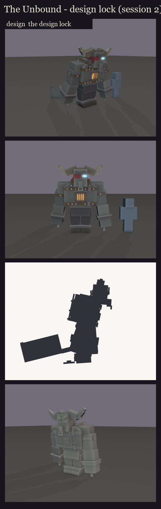
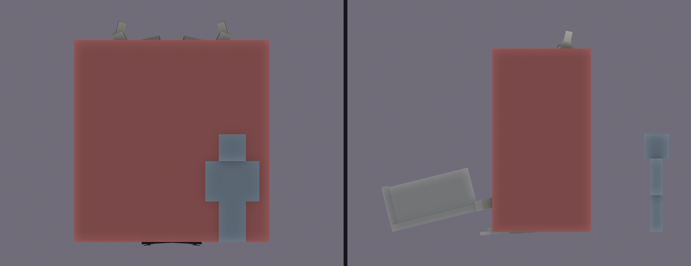

# The Unbound redesign, session 2: design lock

The approved blockout ([../s1_blockout](../s1_blockout/README.md)) is rebuilt as a rig and locked:
- the locked head: F3's horn boss, buffalo horns, iron nose ring and cyan eye; F2's scowl and slipping ragged band;
- the burning chest piece;
- the bare, buff, hunched body with trousers;
- shackles and chains on all four limbs;
- the Frenzy Cleaver as a real butcher's cleaver.

It is scaled to the planned size, and every cube is snapped to whole texels.

## Size and hitbox

- **Model:** about 3.25 blocks to the top of the head and 3.8 to the horn tips. He's 3.2 wide with his arms hanging
  past his knees; the player is 1.8.
- **Hitbox:** one invisible `ob_hitbox` bone, 3.25 x 3.4 x 1.8 blocks: a column over his body and arms, from the floor
  to the top of his head.
  - The horns, the band's tails, the chains and the cleaver stay outside it, so nothing loose is a free target and
    the dragged cleaver can't be hit from behind.
  - It's one box, so a sweep can't hit him twice.

## Bones (BetterModel names)

**The bones:**
- `root`: the hips;
- `torso`: the hunch; chest, back, straps and the chest piece;
- `hi_head`: the head, which turns with its children;
- `horn_left`, `horn_right`;
- `band_tails`: the cloth's ends, which swing;
- `leg_*` and `shin_*`;
- `arm_*` and `forearm_*`;
- `cleaver`: in his right fist;
- `chain_wrist_*` and `chain_ankle_*`: the chains swing on their own bones.

**Glow bones:** `glow_eye` (the cyan eye through the band) and `glow_chest` (the fire behind the grate), drawn
full-bright in game. The fire's stages as he speeds up can be tints and brightness on `glow_chest`, never a scale on a
bone that holds other parts.

**Counts:** 122 cubes and 21 bones with geometry, so about 21 displays. Full list: [parts.md](parts.md).

**How the cleaver is held** (flipped after the user's review: the first take led the sweep with the spine): its edge faces where the swing carries it in every pose:
- up while he drags it;
- up behind his shoulder in the wind-up;
- down and forward at the end of the sweep.

The pose script aims the cleaver and the chains in world space: the chains always hang, and the cleaver never comes
round backwards.

## Key poses

The fight's moments, posed from the rig. They are silhouettes for the design, not animation.

- **Idle and walking:** the cleaver dragged behind him, spine down.
- **The cleave, wind-up:** the cleaver raised above his right shoulder, the blade hanging behind his back, while the
  red wedge shows (changed in session 7's take 2: it was held beside his head, and the swing went under the shoulder).
- **The cleave, sweep:** a lunge, the cleaver down and through in front of him.
- **Calling the thralls:** a roar, head thrown back, arms spread.
- **Devouring a thrall:** hunched over, his fist to his mouth.
- **Sated:** down on one knee, slumped, the cleaver dropped flat beside him (the 3 s opening).
- **Enraged charge:** head down and horns first, arms back, a long stride.
- **Death:** on his knees, folding forward, the cleaver dropped.

Walking, the swings in motion and the fire's stages are left for the animation session (7).

Regenerate with `python tools/art/bosses/unbound_s2.py`. The editable blockout with its hitbox is in `design/`.
