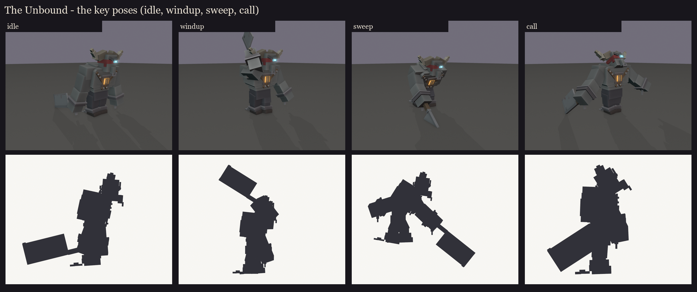
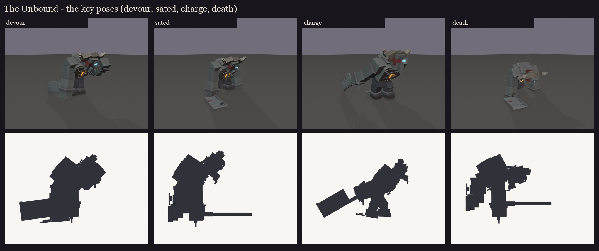
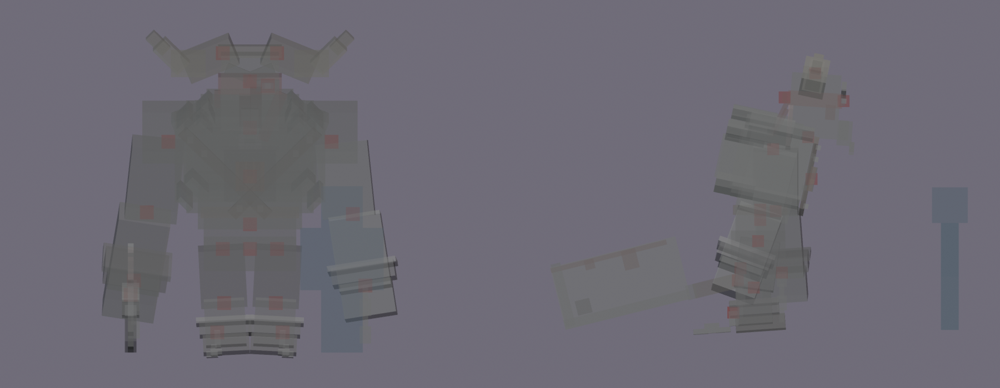

# The Unbound redesign, session 3: rig and pose test

This makes the approved design lock ([../s2_design](../s2_design/README.md)) ready to move and to see in game:
- the joints are checked;
- the bone names are checked against BetterModel's tags;
- the drawing cost is counted and cut;
- the eight key poses are saved as animations;
- each material gets a flat colour, so BetterModel can show him before texturing. The cyan eye and the chest fire
  are drawn full-bright.

| Pose | What it tests |
|---|---|
| idle | the hunch, the cleaver dragged spine-down |
| windup | the cleaver over his right shoulder, edge up |
| sweep | the lunge, the edge leading the cleaver down and through |
| call | the roar, arms spread |
| devour | hunched over, fist to his mouth |
| sated | down on one knee, the cleaver dropped (the root sinks; a position key) |
| charge | head down, horns first |
| death | on his knees, folding forward |




## Rig checks ([rig_report.json](rig_report.json))

- **Pivots:** every bone pivots inside its joint ([pivots.md](pivots.md)).
  - The torso turns at the waist for the hunch, the head at the neck, each arm at the shoulder and each forearm at the
    elbow.
  - The legs turn at the hips and the shins at the knees.
  - The cleaver turns in his fist.
  - Each chain hangs from its shackle, and the band's tails from the knot.
  - One fix: the root's pivot was on the floor, under his feet; it now sits in his hips, so the kneeling poses sink
    him from there.

  
- **BetterModel tags:** only the intended bones carry one:
  - `hi_head` turns with its children (the horns, the band's tails and the eye);
  - `glow_eye` and `glow_chest` are drawn full-bright;
  - `ob_hitbox` is the invisible hitbox.
- **Drawing cost:** 21 bones with cubes (116 cubes since session 4's fixes), drawn as **21 display entities**. The first count was 42.
  BetterModel gives a cube its own display unless it is turned on one axis by 0, 22.5 or 45 degrees.
  - The straps, the brows, the torn flap, the band's tails and every horn piece were at odd angles.
  - They now use those angles: the straps cross at 45 degrees, the brows and the horn pieces step by 22.5.
  - The look barely changes. The horns sit a little lower (3.56 blocks to the tips).
  - The band's 7-degree slip had a display of its own; session 4 straightened the band, so that's gone too.
  - For comparison: Brood Mother draws 71, Volley 56, the coven 51 for all three.
- **Load test:** on the second test server, BetterModel loaded the rig with the shipped models and no warnings
  ("7 of models are loaded successfully"). It was then taken off that server again, since its models folder must hold
  only shipped models for pack builds.

## In game

The review model has flat material colours and no texture yet. It is in `run/plugins/BetterModel/models` (your
server on port 25565), isn't shipped, and holds each pose as an animation:

```
/bm reload
/bm test occultech_unbound_rig idle
/bm test occultech_unbound_rig windup
/bm test occultech_unbound_rig sweep
/bm test occultech_unbound_rig sated
```

Regenerate with `python tools/art/bosses/unbound_s3.py` (after `unbound_s2.py`).
