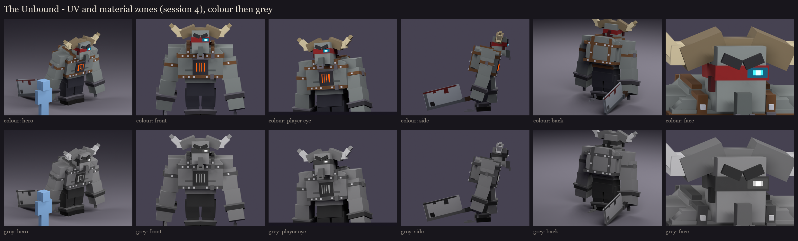
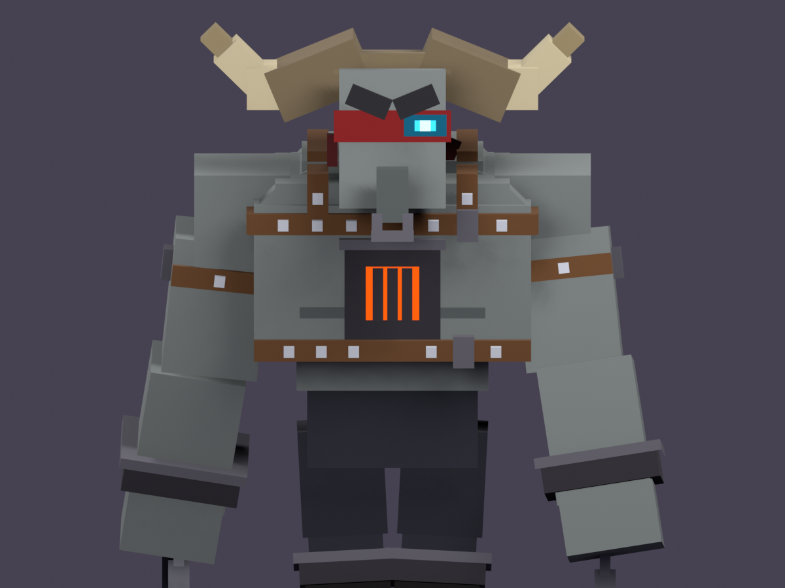
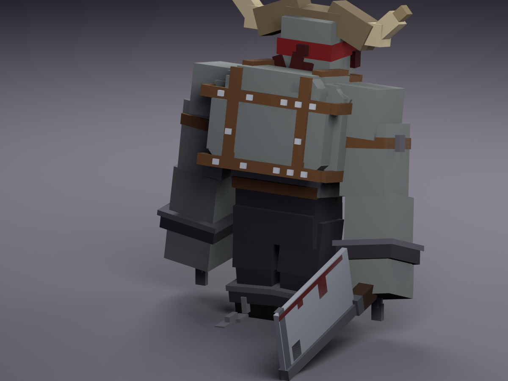

# The Unbound redesign, session 4: UV and material blocking

On top of the session 3 rig ([../s3_rig](../s3_rig/README.md)):
- **One atlas**, 256 x 256 (135 rows used, a little over half full, so session 5 has room). Every visible face is
  at one texel per model unit (16 per block, the vanilla density), with a 1-pixel border on each island against
  seams.
- **Shared where truly identical:** a left limb, horn, strap, brow or stud uses its right twin's islands. That gives
  625 islands for 826 drawn faces.
- **Buried faces left out:** 110 faces that sit inside another cube of the same bone get no texture and are never
  drawn.
- **A flat colour per material zone, tied to vanilla's vindicator:**
  - grey skin, the heavy dark brow and nose;
  - dark trousers and near-black boots;
  - on top of that: the red band (its knot, tails and torn flap a darker red), bone horns with a darker boss and tips,
    leather straps with silver studs, blackened iron (the chest piece and shackles) with lighter rims and the nose
    ring, steel chains, and the steel cleaver with a dark spine, a leather-wrapped handle and dried blood on its edge.

  The eye's spirit cyan and the chest fire are the only saturated colours, and are drawn full-bright.
- **The in-game review rig** (`occultech_unbound_rig`) now carries this atlas, so the pixel size can be judged in
  game. It is in `run/plugins/BetterModel/models`. On the second test server it loaded with the shipped models and
  no warnings, and was then taken off it again.



## Model fixes after the first review

- **The red band** was a slab tilted 7 degrees and larger than the head, with the scowl stacked above it, and it read
  oddly. It is now a snug, straight wrap. The scowling brows press down onto its top edge, a torn flap hangs at his
  right temple, and the knot and tails stay behind. (Tatters along its lower edge were tried and dropped: they read as
  blood running down his face.)
- **The leather straps** are now restraints (take 3). The crossed straps of the first two takes floated on his front
  and ran over the chest piece. Now:
  - two studded leather bands go all the way round his torso: one over his chest above the chest piece, one round his
    ribs below it, each with an iron buckle;
  - a harness strap over each shoulder joins them, running up his front, over the top and down his back;
  - a band round each upper arm, with a stud and a buckle;
  - nothing crosses the chest piece;
  - all the strap pieces are unturned boxes, so they add no displays.
- Model: 156 cubes, 21 bones, 21 displays.




## The value check

The grey row is the same renders with the colour taken out. The skin, the horns and the studs carry the figure, the
trousers and boots sink, and the eye and the fire are what you see first. Every pair of neighbouring zones is at least
12 apart in lightness. Four pairs were too close at first and were spread:
- the nose on the face (darkened);
- the band's knot and tails on the band (darkened);
- the boots under the trousers (darkened);
- the leather straps against the trousers (the leather became a lighter brown).

| Zone | Colour | Lightness | | Zone | Colour | Lightness |
|---|---|---|---|---|---|---|
| skin | 126, 132, 130 | 55 | | iron | 56, 54, 60 | 23 |
| nose, pec line | 92, 98, 97 | 41 | | iron rims, nose ring | 104, 102, 110 | 44 |
| brow | 44, 44, 48 | 18 | | chain | 128, 128, 136 | 54 |
| band | 134, 30, 32 | 30 | | trousers | 48, 48, 58 | 20 |
| band knot, tails | 70, 14, 18 | 14 | | boots | 20, 17, 17 | 5 |
| horn | 196, 184, 152 | 75 | | cleaver steel | 156, 162, 168 | 66 |
| horn boss | 124, 110, 86 | 47 | | cleaver spine | 90, 94, 100 | 40 |
| horn tips | 150, 136, 104 | 57 | | handle wrap | 66, 46, 30 | 21 |
| leather | 112, 78, 48 | 36 | | blood | 94, 18, 18 | 19 |
| studs | 198, 202, 210 | 81 | | fire / hot | 236, 92, 18 / 255, 186, 70 | 58 / 80 |
| eye / core / halo | 70, 210, 250 / 200, 248, 255 / 26, 92, 116 | 79 / 95 / 36 | | | | |

The atlas itself: [atlas_preview.png](atlas_preview.png) (2x). Full numbers: [uv_report.json](uv_report.json).

## In game

```
/bm reload
/bm test occultech_unbound_rig idle
/bm test occultech_unbound_rig windup
```

Regenerate with `python tools/art/bosses/unbound_s4.py` (after `unbound_s3.py`).
