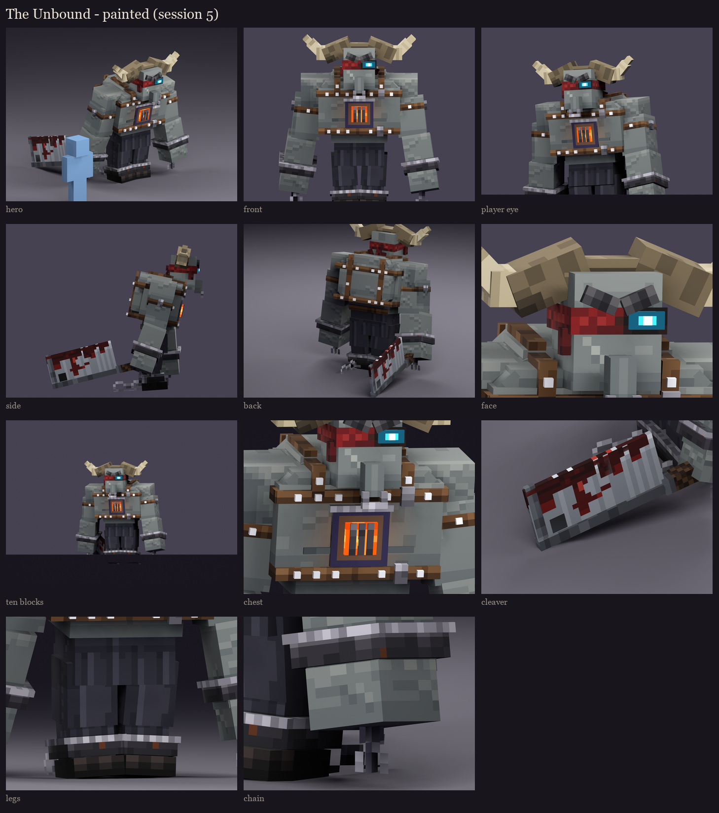

# The Unbound redesign, session 5: texture painting

The session 4 layout ([../s4_uv](../s4_uv/README.md): one 256 x 256 atlas, the same islands) painted with fine ramps:
close shades, cool shadows and warm lights, so detail can be subtle. Form only, no painted light direction: ambient
occlusion is baked from the real geometry, so creases darken where parts meet.



**Skin:**
- vanilla's vindicator grey, lightly mottled;
- the tops of his shoulders, traps and chest catch the light and the undersides fall into shadow;
- the abs on his stomach;
- a few old welts where the restraints bit, each with a lit edge;
- **the fire's light**: the chest piece's glow spills warm orange onto the skin round it, fading with distance and
  blended in, so it reads as light on the skin, not paint.

**The face:**
- a lit forehead with a furrow over the scowl;
- cheekbones and a jaw in shadow;
- a pale scar across his cheek;
- the heavy brow in bristles.

**The band:** woven red cloth, darker at its edges and frayed along the bottom, with a scorched ring round the
burning eye. The knot, tails and torn flap are a darker red with folds and frayed ends.

**The horns:** bone with growth rings across their length, lighter towards the tips, an occasional chip; the boss
across his skull rough and darker.

**Leather and iron:**
- **The restraints:** leather with scuffs, creases and stitching; the studs silver with a highlight.
- **The chest piece and shackles:** blackened iron, hammered and pitted, the edges worn bright, rust in the pits. The
  chest piece's rim is tempered by the heat, violet to bronze round the grate.
- **The chains** (take 2, after the user's review: the first were flat sticks): built like vanilla's chain, as two
  crossed cut-out planes per run. They are painted with 4-texel links that alternate between face-on rings, rounded
  with an open middle, and side-on links, the crossed plane offset half a link. The wrist chains hang; the ankle
  chains hang to the floor and lie along it behind him. That's two cubes per run, no extra displays.

**Trousers and boots** (take 2, after the user's review): dark cloth carried by its folds rather than by noise:
- long soft folds, each a shadow with a lit edge;
- seams with stitching down the sides;
- two creases bunched at each knee;
- the thighs worn lighter;
- frayed hems with dirt rising from the boots.

The boots are black leather with a sole edge. The baked shadow on the cloth is gentler, since the thigh overlapping
the knee printed blots. A stitched patch was tried and dropped: at this size it read as a cross.

**The cleaver:**
- brushed steel streaked along its length;
- a bright honed bevel along the edge;
- **the blood** (take 2, after the user's review):
  - caked thick along the edge, heaviest towards the tip;
  - runs dripping from the edge down the flat, each ending in a drop;
  - a smear wiped along the flat;
  - spatter in clusters;
  - dried dark brown-red, with fresh red spots and a few wet glints;
- a darker spine, a leather-wrapped handle, and the dark hanging hole.

**The glow:** the fire hot in the middle and orange at its edges, flickering; the eye a white-cyan core in cyan, its
halo fading out. Both are drawn full-bright in game.

**Take 1** (this session) was too noisy: the skin read as stone, the horns as cork, the trousers as a checkerboard,
and the firelight was a hard brown square that looked like a second plate. The noise is now larger, rarer and
softer, and the firelight is blended in.

**The in-game review rig** (`occultech_unbound_rig`) carries this atlas. It loaded on the second test server with the
shipped models and no warnings, and is in `run/plugins/BetterModel/models` on yours:

```
/bm reload
/bm test occultech_unbound_rig idle
/bm test occultech_unbound_rig windup
```

The atlas: [atlas_preview.png](atlas_preview.png) (2x). Regenerate with `python tools/art/bosses/unbound_s5.py`.
