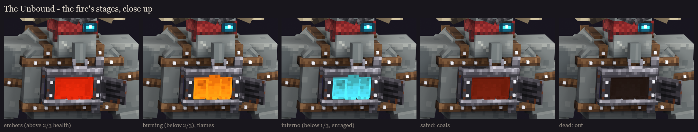
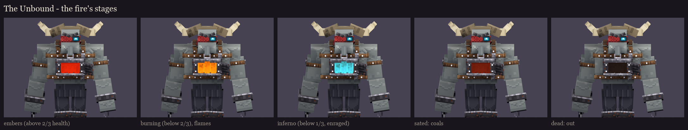
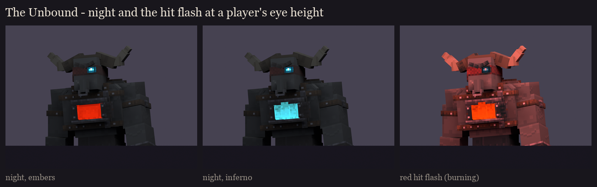

# The Unbound redesign, session 6: variants and readability

His variants are **the fire's stages**. He speeds up as he loses health, and the fire in his chest grows with him.
The fire is painted near white (session 5), and in the fight BetterModel's per-bone tint multiplies the stage's
colour into it, so there is no texture swap. New this session: **flames rising out of the furnace**, on their own
bone `glow_flames`, which starts hidden and is shown as the fire grows (BetterModel's part visibility).

**Take 2** (after the user's review in game):
- **The flames:** take 1's rose up over his chin and coloured the bottom of his face. They now rise off the coals
  inside the mouth and stop under the lintel.
- **The furnace:** the chest piece is rebuilt as a bigger, plain furnace front. It fills his chest between the two
  bands, with a square mouth framed by heavy jambs, a lintel and a jutting hearth. The fire is at its back, with lit
  inner walls and glowing coals, and the door hangs open on its hinge at his left.
- **Colours far apart:** take 1 had three shades of orange; now it's red, orange, then the tier's spirit cyan.
- **No painted firelight:** the warm light painted on the skin round the chest is gone. It stayed orange at every
  stage.

| Stage | When | Tint (RGB) | Flames |
|---|---|---|---|
| embers | above 2/3 health | 200, 44, 14: a deep red glow in the furnace | hidden |
| burning | below 2/3 | 255, 150, 24: bright orange | shown |
| inferno | below 1/3, enraged | 80, 214, 255: spirit fire, cyan like his eye | shown |
| sated | the 3 s after he devours a thrall | 110, 36, 20: dull coals | hidden |
| dead | as he falls | 40, 30, 28: the fire goes out | hidden |

**The tinted bones** are `glow_chest` (the furnace's fire, lit walls and coals) and `glow_flames`. Fight particles
(session 8) pour out of the furnace, more at each stage:
- **embers:** sparks and smoke;
- **burning:** flames, lava pops and more smoke;
- **inferno:** spirit-fire flames, lava, heavy smoke and spirit fire round his feet.

## How it works in BetterModel (as checked for the Witch Coven, 3.5.0)

- **The tint:** `tracker.update(TrackerUpdateAction.tint(rgb), bone -> name starts with "glow_chest" or
  "glow_flames")`, or MythicMobs' BetterModel `tint` mechanic with a part filter.
- **The flames:** `TrackerUpdateAction.togglePart(true/false)` on `glow_flames` (the Brood Mother's candles work the
  same way).
- **The hit flash** (`damageTint`) tints every bone red for about 10 ticks, then restores each bone's previous tint.
  If a stage change lands during a flash, the "previous" tint is the flash's red. So, as for the coven, session 8
  re-applies the stage tint about 12 ticks after every stage change.

## Readability

- **At night** (light level about 4), everything but the full-bright fire and eye dims to a dark silhouette. The cyan
  eye and the fire are what's left, and the stage still reads at a glance in the dark: a red furnace, an orange
  one with flames, or a cyan one.
- **Under the hit flash**, the whole body reddens and the fire stays the brightest thing on him.

He draws 22 displays now (one more, for the flames bone).

Regenerate with `python tools/art/bosses/unbound_s6.py` (after `unbound_s5.py`). Next, session 7: animation (idle,
the walk with the cleaver dragging, the cleave's wind-up and sweep timed to the fight, the thrall call, the devour,
the sated collapse, the charge, death).
