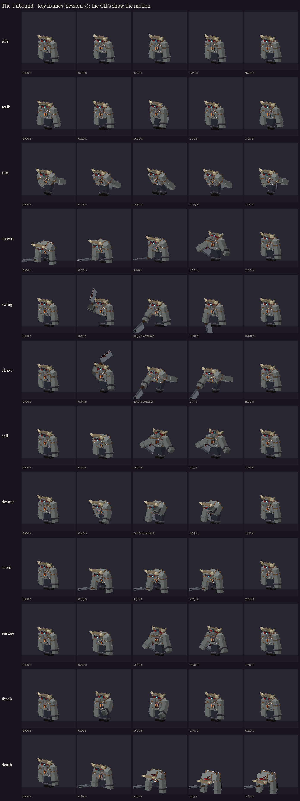
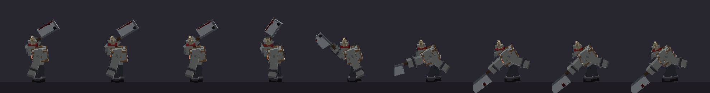

# The Unbound redesign, session 7: animation

Twelve clips on the session 6 rig. Each clip is a few whole poses at key times, built with session 2's pose code, so at
every key the cleaver's edge faces where the swing carries it and the chains hang straight. The keyframes are each
bone's turn away from the rest pose. Kneeling sinks the hips with a position key; a dropped cleaver is set on the
floor with another.

| Clip | Length | Plays | What happens |
|---|---|---|---|
| idle | 3.0 s | loop | heavy breathing: the chest rises and falls, the shoulders roll, the chains and the band's tails sway |
| walk | 1.6 s | loop | a heavy stride, the hips bobbing, the free arm swinging, the cleaver dragging behind |
| run | 1.0 s | loop | enraged (below 1/3 health): head down, horns first, a long stride, arms back |
| spawn | 2.0 s | once | rising from a kneel to a roar (the ritual arrival) |
| swing | 0.8 s | once | the axe swing (melee): a short chop, **contact at 0.35 s** |
| cleave | 2.2 s | once | wound up over his shoulder through the 1.25 s warning, trembling, then the sweep over the top, **contact at 1.3 s**, a heavy recovery |
| call | 1.8 s | once | calling the thralls: he crouches, then roars, arms spread |
| devour | 1.6 s | once | seizing a thrall and gorging, fist to his mouth (**the bite at 0.8 s**) |
| sated | 3.0 s | once | the 3 s opening: down on one knee by 0.4 s, panting, back up at the end |
| enrage | 1.2 s | once | a stage change: a short roar as the fire flares |
| flinch | 0.4 s | once | hit: a jolt, layered over whatever he's doing |
| death | 2.6 s | hold | to his knees, then folding forward, the cleaver dropped |

The action clips (swing, cleave, call, devour, enrage, flinch) override only the bones they move, so the breathing
goes on underneath.



**The cleave, from the side** (0.6 to 1.6 s): the blade waits behind his shoulder, edge up, then comes over the top
and down in front, edge first.



The GIFs in `gifs/` show each clip moving (flat zone colours, the fire at its burning stage).

## For the fight code (session 8)

- **Lead times:** start each clip early enough that its contact lands on the server's moment:
  - **cleave** with the warning, about 1 tick early (contact at 1.3 s, the warning is 1.25 s);
  - **swing** 7 ticks before the hit;
  - **devour** 16 ticks before the thrall dies.
- **Sated** plays for the whole 60-tick opening. Nothing blocks the player's hits during it.
- **Walk** for normal movement and **run** once he's enraged (below 1/3 health). **Enrage** plays at each stage
  change, with the stage tint (session 6).

**Load test:** the animated rig loaded on the second test server with the shipped models and no warnings, and is on
your server:

```
/bm reload
/bm test occultech_unbound_rig cleave
/bm test occultech_unbound_rig walk
/bm test occultech_unbound_rig sated
```

Regenerate with `python tools/art/bosses/unbound_s7.py` (after `unbound_s5.py`).
