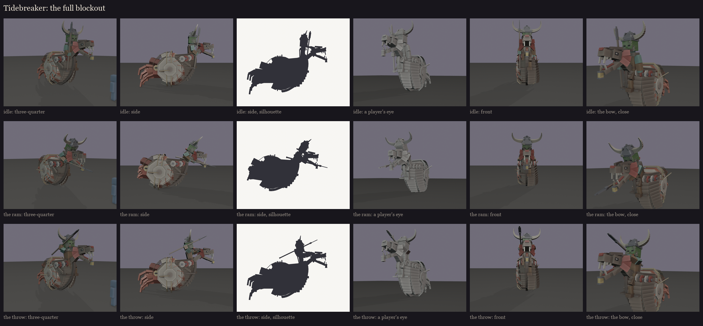

# The Tidebreaker, session 1 step 3: the full blockout

Made by `python tools/art/bosses/tide_blockout.py <folder with the 26.2 zombie textures>`.

**The picks (2026-11-08):** take 2's Viking Longship, S2 the Dragon, and F3 for the head.

3.1 x 6.3 x 7.9 blocks, 870 preview cubes. 256 of those are the head's texel tiles, which become one painted cube in the
real model. Colours away from the face are still zones.

## Changed to fit them together

- **The dragon sits lower and further out** than in its study, on a slimmer, more forward-reaching neck. At the study's
  height it hid the Viking from every angle; now his head and shoulders stand clear above it.
- **The neck of the Viking** is the study's: the bust's fur collar lands on the body's collar.

## Poses

Idle (spear upright), the ram (couched like a lance, the whole boss nose down) and the throw (drawn back over the
shoulder).

## For the review

From directly ahead the dragon still covers his chest and legs. The red cheek fins cover part of his body from a
three-quarter view; they can be made smaller if he should show more.

## Next

Once this is approved, session 2: the rig for two models (the mount on the nautilus, the Viking on the drowned) and the
key poses.
