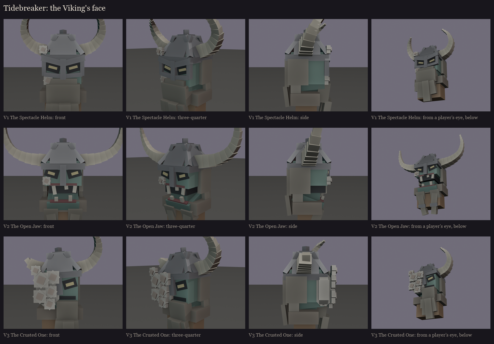
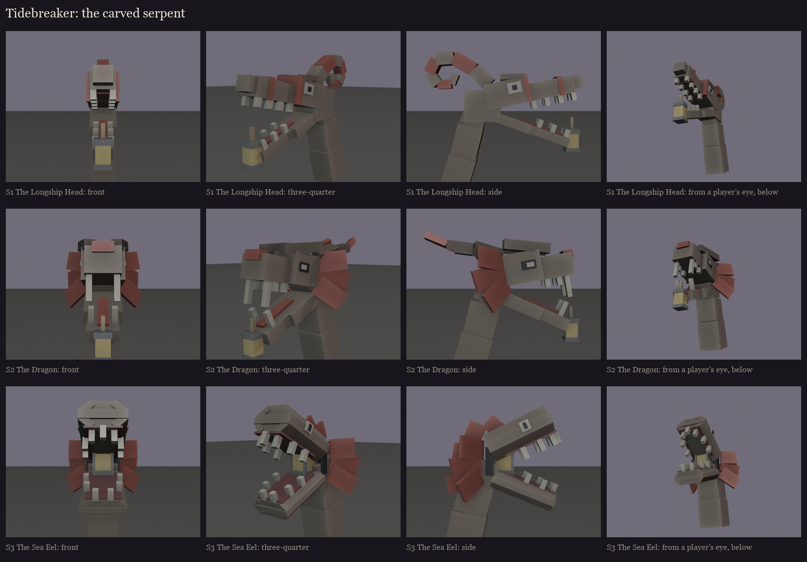

# The Tidebreaker, session 1 step 2: the two faces

Made by `python tools/art/bosses/tide_faces.py [V1 V2 V3 S1 S2 S3]`. Take 2, the Viking Longship, was approved on
2026-11-08. These are real cuboids at the size they have on the model. The colours are zones; carving lines, wear and
barnacle openings are texture later.

## The Viking

All three share a four-plate ribbed helmet (a spangenhelm), matted hair out from under it, and the fur collar.

| Version | The face | The horns | Reads as |
|---|---|---|---|
| **V1, the Spectacle Helm** | an iron guard round both eyes, slanted into a scowl; the glow deep in its sockets; a heavy beard in uneven hanks | a crescent curving in | a mask, the most Viking and the clearest from below |
| **V2, the Open Jaw** | a nose guard only; sunken slanted eyes, the jaw hanging, a few broken teeth, two ringed braids | wide ox horns | the most drowned and the most character |
| **V3, the Crusted One** | barnacles swallow half his face and one eye; a single eye burns in the other half; a half beard | one crescent, the other snapped to a stump | the most mutated and asymmetrical |

## The carved serpent

| Version | The head | The lantern | Reads as |
|---|---|---|---|
| **S1, the Longship Head** | long and narrow, jaws open, a carved curl rising behind the skull, painted bands | hangs from the lower jaw | the true Viking prow; the curl is its silhouette |
| **S2, the Dragon** | a broad skull, a heavy brow, two swept horns, webbed cheek fins, two great fangs | hangs from the lower jaw | a dragon, the heaviest |
| **S3, the Sea Eel** | a round gaping head with rows of teeth, webbed gills, a fin down the neck | lit inside its throat, seen through the open jaws | the scariest; a light in the mouth |

## Fixed in self-review before showing

- **The helmet** was a house roof, then a pagoda. It is now a low four-plate helm with ribs and no eaves.
- **The horns** were chunky bent segments with gaps. They now follow a smooth curve and taper to a point.
- **The eyes and teeth** read as a robot and dentures. The eyes are slanted into a scowl, and the teeth are few and
  broken.
- **Barnacles** with square holes read as extra eyes. They are turned plates now; the openings will be painted.
- **The side of his head** was a bare green cube. Matted hair covers it now.
- **The serpents' fins** were sticks and are webbed now. S1's snout no longer ends in a red hammer, and S3's lantern
  shows through a barred cage.

## For the next step

Pick one Viking and one serpent, or mix parts. Step 3 is the full blockout with those faces on the longship.
