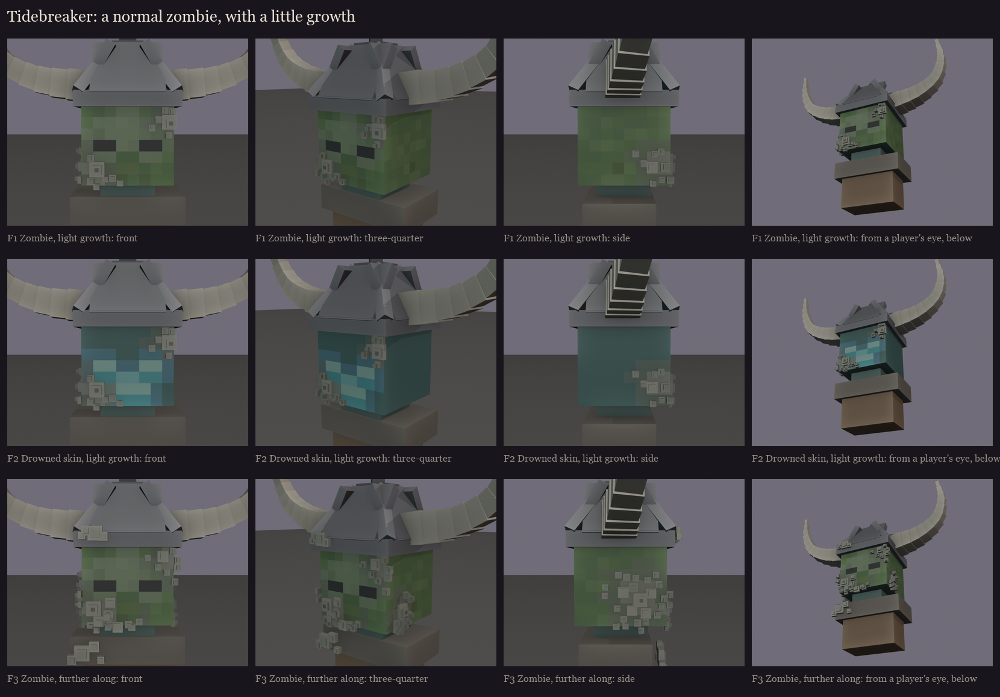

# The Tidebreaker, session 1 step 2, round 2: a normal zombie

Made by `python tools/art/bosses/tide_faces2.py <folder with the 26.2 zombie textures>`, after
[round 1](../s1_faces/README.md).

**The review (2026-11-08):**
- **S2, the Dragon, is the serpent.**
- None of the Viking faces. The barnacles looked bad.
- He should be a normal Minecraft zombie with little barnacles growing on him, like the crew in Pirates of the
  Caribbean.

## What the references show

From stills of the Flying Dutchman's crew (Bootstrap Bill and the group shots):
- **The face stays a face.** On the less-far-gone crew you still read the eyes and the mouth.
- **Growth comes in patches** at the edges: cheek, jaw, temple, and then the clothes.
- **Sizes are mixed:** a few bigger shells inside a patch, small ones scattered round it.
- **The skin changes under it,** so the shells look grown in, not stuck on.

## What this does

- **The head is vanilla's:** 8 x 8 x 8 at 1.45 times. The preview colours every texel from the real 26.2 skin. No
  jaw, no beard, no guard.
- **The helmet** stays, with the wide ox horns. Only its band covers the top row of the head, and there is no nose
  guard, so the zombie's face stays clear.
- **The barnacles** are small and low, about a texel or two across. Each is a plate with a smaller cap set off its
  centre. Only the biggest show an opening.
- **Painted crust** under each patch stains the skin. The eyes and the mouth are kept bare.

| Version | Skin | Growth |
|---|---|---|
| **F1** | zombie | light: one cheek, the opposite temple, the side of the jaw |
| **F2** | drowned (the mob he really is) | the same. The vanilla drowned has no dark eyes: its face is lit patches |
| **F3** | zombie | further along: the jaw and side of the head, onto the helm's band and the collar |

## Next

Pick F1, F2 or F3, or say how much growth you want. Step 3 is the full blockout with S2 and that head on the longship.
