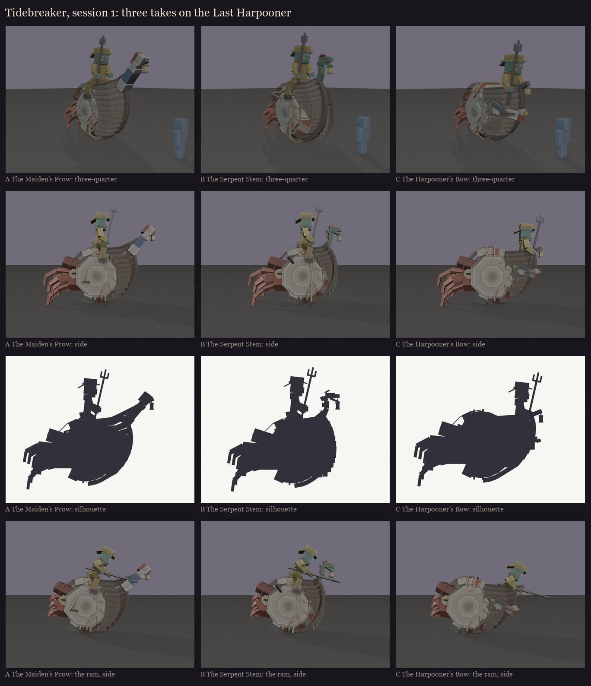

# The Tidebreaker, session 1 step 1: three takes on the Last Harpooner

Made by `python tools/art/bosses/tide_silhouettes.py [A B C]`. The brief is in [the plan](../plan.md).

## What all three share

- **The nautilus:** 3.25 blocks across and 1.75 wide. It hovers a few pixels off the floor.
  - **The coil:** a narrow, rounded keel, with flanks domed in three steps to the dark callus at the centre.
  - **The tiger stripes,** from the vanilla nautilus: they cross the keel and run in from the rim, fading before
    the centre.
  - **The animal** sits in the opening at the back: a leathery hood sloping over the body, a big eye on each side,
    the siphon underneath.
  - **The tentacles** trail behind and curl down.
- **The bow leads,** because a real nautilus swims shell first with its tentacles trailing. The wreck's bow is his
  battering ram.
  - **The planks:** horizontal strakes run from the stem round the shell's front, rising towards the stem (the sheer)
    and closing in a sharp V when seen from the front.
  - **The stem post** curves under the shell into an iron-shod forefoot, the ram's cutting edge.
  - **Rope lashings** hold the bow on: you can see it's a piece of ship tied onto the animal.
- **The lines and nets:**
  - a fishing net thrown over the back of the shell;
  - old harpoons stuck in the shell, their lines running up to where he rides.
- **The whaler:** a drowned at 1.3 times. A sou'wester with a long brim at the back. A mouldy oilskin coat with a
  barnacle crust on one shoulder. A barnacled face with the jaw hanging open, and glowing eyes, his only light
  besides the lantern. The harpoon has the vanilla trident's shape.
- **Both poses:**
  - **Idle:** the harpoon held upright.
  - **The ram:** the bow dips, the tentacles pull in, and he leans in with the harpoon lowered like a lance.

## The takes

| Take | The piece of ship | Where he rides | Reads as |
|---|---|---|---|
| **A, the Maiden's Prow** | a merchantman's smooth carvel bow; a bowsprit with the whaler's lantern at its tip; a carved maiden (blue robe, arms crossed, hair blown back) leaning out under it | sitting on a lashed wooden saddle on the shell's crest | the most "ship": the bowsprit and the maiden make a long diagonal forward, a clear direction for the ram |
| **B, the Serpent Stem** | a clinker bow (overlapping planks); the stem post rises and curls into a carved sea serpent, jaws open, with the lantern hanging from its mouth | sitting on the crest | the most compact and the most monstrous: the serpent reads as a second head, facing the target |
| **C, the Harpooner's Bow** | a bigger, broken bow section (ragged plank ends at the back, a stub of bowsprit); a carved eagle at the stem with its wings spread back along both sides | standing braced in the bow like a whaleboat's harpooner, spare harpoons racked beside him, the shell rising behind him | the most "whaler": he stands at the very front, nearest the players, so he is the easiest to hit |

## Checks

- **The rider is never covered.**
  - In A and B he sits above everything. His body is reachable from beside the shell: the hitbox's lower edge is
    within 3 blocks of a player's eyes.
  - C's first pass hid him inside the bow up to his chest. Its gunwale now stops at his hips.
- **Nothing decorative looks like a weak spot:** the figurehead and the lantern are wood and light, not flesh.

## Fixed in self-review before showing

- **The coil read as a beach ball** under a big rider. It is bigger now (3.25 blocks), so the nautilus is the colossal
  part.
- **The flanks:** the first round plates were turned squares, which made stars, and the shell read as a car tire.
  The flanks are true octagons now, domed in three steps, on a narrower keel.
- **The bow was a flat-faced crate.** It now has sheer, a sharp V and a raked stem.
- **The stripes read as wheel spokes.** They now run in from the rim and fade out.
- **The tentacles were a broom of straight sticks.** They now curl down in three segments.
- **The figurehead:** the maiden was too small to see, then lay flat along the bowsprit. She is 1.7 times bigger
  now, leaning out at 40 degrees.

## For the next step

Pick a take (or mix: for example, B's serpent on A's bowsprit, or C's standing pose on A). Step 2 then studies the
figurehead and the whaler's face under the sou'wester close up. The colours here are zones only; no texture yet.
