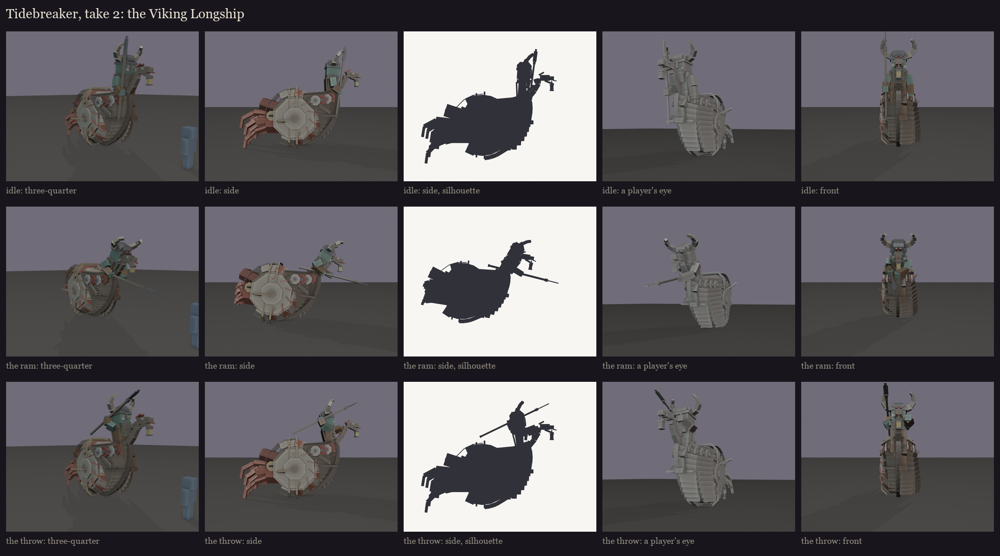

# The Tidebreaker, session 1 step 1, take 2: the Viking Longship

Made by `python tools/art/bosses/tide_take2.py`, built on [step 1](../s1_silhouettes/README.md).

**Your pick (2026-11-04):**
- B, the Serpent Stem, because it reads as a Viking ship;
- the rider standing in the bow like C's harpooner;
- the whaler replaced by a drowned Viking: a horned helmet, torn leather clothes, and a long spear he throws.

## What changed

- **The bow** is B's clinker bow (overlapping strakes), with sheer up to the stem.
  - **The gunwale:** lowered to his hips, as in C, so he stands in plain view.
  - **A short deck** under him, and a thwart behind him to brace against.
  - **The shields:** a row of round longship shields hangs overlapping along the rail, painted red and white
    round iron bosses.
- **The serpent stem:**
  - **Colour:** carved wood with red paint. In green it melted into the drowned's skin.
  - **Position:** the neck leans out ahead of him, so a block of air separates the serpent's head from his face in
    every view. The first pass merged them into one shape.
  - The lantern still hangs from its jaws.
- **The drowned Viking**, at 1.45 times (up from 1.3; he is the only target, so he must read from across the arena):
  - **The helmet:** an iron dome with a brow band and a nasal. Two horns curve out, up and forward to a point, a
    bull's crescent. The first horns stood straight up like goalposts.
  - **The face:** the drowned's green skin, a matted beard, barnacles on the cheek and a shoulder, and glowing eyes
    under the helm.
  - **The clothes:** a torn leather tunic whose hem hangs in uneven strips, a tear across the chest showing skin, a
    belt with an iron buckle, a fur collar, and a tattered cloak down his back in strips. Bare drowned arms with
    leather bracers, and leather leg wraps.
  - **The long spear:** about 3.4 blocks, with an ash shaft, an iron socket and a broad leaf blade. Spare spears are
    racked inside the bow.
- **The lines and nets stay:** the net over the back of the shell, and old spears stuck in the shell with their lines
  running up to the bow.

## The poses

- **Idle:** braced, the spear upright beside him.
- **The ram:** the bow dips, the tentacles pull in, and he leans in with the spear couched like a lance.
- **The throw** (the trident volley; his throws become spears): leaning back, the spear drawn over his shoulder, the
  left arm aimed at the target.

## Checks

- **In reach:** the gunwale stops at his hips, and his body is about 2.6 to 4.5 blocks up, at the very front of the
  mount. That's within reach of anyone standing at the bow, and from beside the shell.
- **The serpent** stands clear ahead of him, so nothing covers him from the front, the side or the three-quarter view.

## For the next step

**Once you approve this:** step 2 studies the faces close up: the carved serpent's head, and the Viking's face under
the helmet (the horns, the beard, the barnacles, the glowing eyes). Step 3 is the blockout. The colours here are
zones only; no texture yet.
