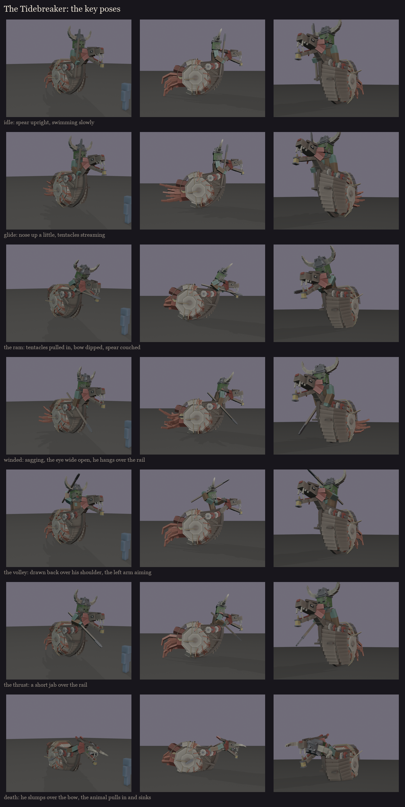

# The Tidebreaker, session 2: design lock

Made by `python tools/art/bosses/tide_s2.py <folder with the 26.2 zombie textures>`.

## Two models

| Model | Worn by | Cubes | Bones with cubes | Hitbox |
|---|---|---|---|---|
| `occultech_tidebreaker_mount` | the zombie nautilus (can't be hurt) | 406 | 52 | the shell (it passes nothing useful: the mob is unhittable) |
| `occultech_tidebreaker` | the drowned (the only target) | 208 | 14 | 1.25 x 3.25 x 1 blocks, his body only: not the horns or spear |

Bone by bone: [parts.md](parts.md). Sizes: [stats.json](stats.json). Blockout rigs: `design/`.

## Decisions

- **He is 1.5 times a drowned, up from 1.45,** so a vanilla 8-texel head is exactly 12 units.
- **The figurehead never moves:** it is carved wood. Only its lantern swings.
- **The eye has a lid and a pupil of its own,** for the winded opening.
- **Cube sizes are whole texels,** except the barnacles, which keep their approved small sizes on a half-texel grid.

## Review changes

- **He stands further back:** he was too close to the front of the deck. His left foot is on the deck and his right is
  braced up on the curve of the shell. The feet are solved to fixed marks, so they stay planted in every pose. The
  bench across the bow is gone: his legs need that space.

## For later sessions

- **Session 3:** the long spear must be split (item models stop at 48 units), and odd cube angles cost display entities.
- **Session 4:** a 12-unit head can't carry an 8-texel skin evenly at one pixel per unit. Painting it at 24 x 24 (3 pixels
  per skin texel) keeps it crisp, as a documented exception to the single density.
- **Session 8:** the rider's model has to line up with the deck at the game's real passenger seat, and follow the
  mount's pitch in the ram and winded poses, since the two are separate entities.

## Floor

The fight holds him 0.4 blocks up (6.4 units). Idle and the attacks stay inside that; only the death goes through the
floor, on purpose.
