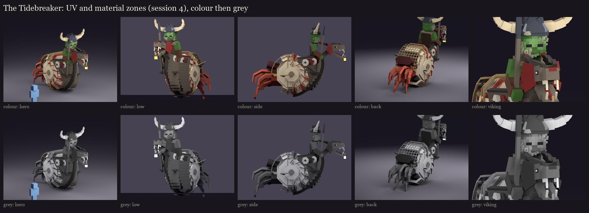

# The Tidebreaker, session 4: UV and material zones

Made by `python tools/art/bosses/tide_s4.py <folder with the 26.2 zombie textures>`.

| Model | Atlas | Islands | Faces drawn |
|---|---|---|---|
| `occultech_tidebreaker_mount_rig` | 512 x 256 | 1714 | 2390 |
| `occultech_tidebreaker_rig` | 512 x 64 | 1046 | 1171 |

Both review models, with the session 3 poses, are in `run/plugins/BetterModel/models`.

## Zones

- **The nautilus:** vanilla's cream shell and red tiger stripes.
- **The longship:** tarred grey spruce, dark iron, hemp, and dark red paint.
- **The Viking:** the zombie's own green on his head and bare arms (they were sea-green before and didn't match), torn
  dark leather, a pale fur collar, ox horn.

Value check: every pair of neighbouring zones is at least 12 L* apart, so he reads in grey.

## Exceptions to one density

- **The head** is 24 x 24 on 12-unit faces, three pixels per skin texel. It already carries the real 26.2 zombie skin.
- **The barnacles** keep their half-texel sizes.

## Cut-outs

The net is a mesh of cords every four texels, with alpha 0 or 255 only.

## For session 5

The crust and staining under the barnacles, wood grain, plank nails, rust, the shell's nacre and stripes, and worn paint
on the dragon.
