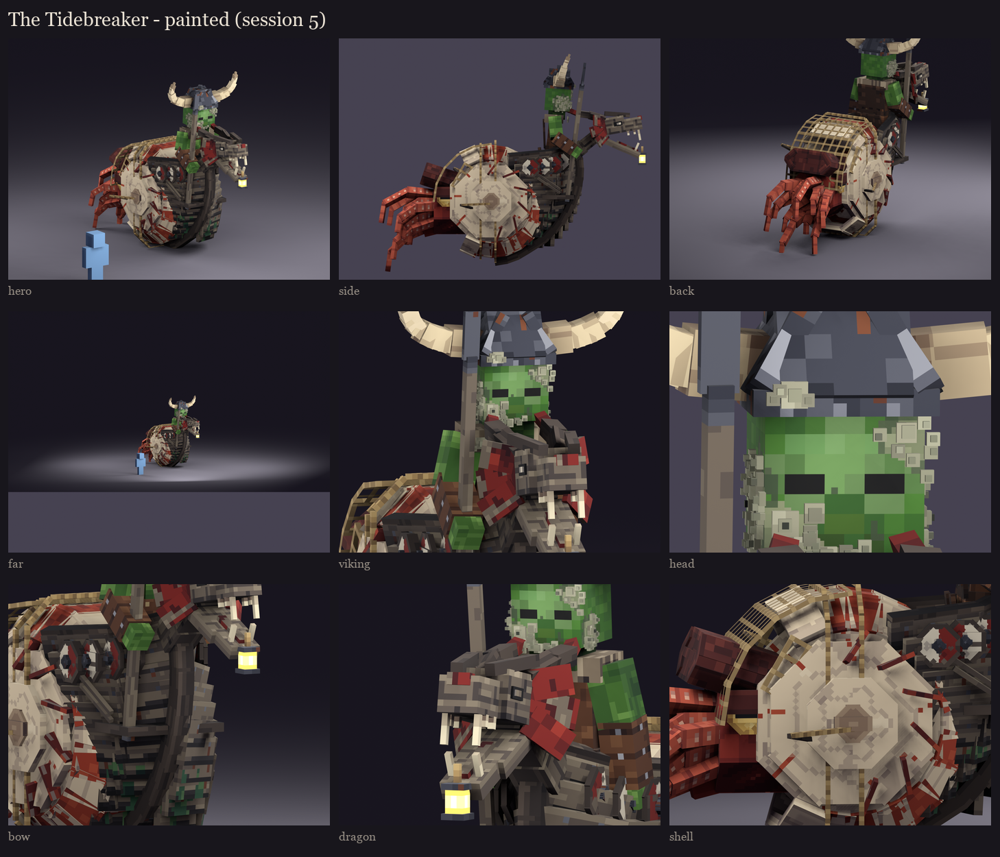

# The Tidebreaker, session 5: painted

Made by `python tools/art/bosses/tide_s5.py <folder with the 26.2 zombie textures>`. It paints session 4's layouts; the
review models with their poses are in `run/plugins/BetterModel/models`.

- **The shell:** cream with concentric growth rings, soft age patches, and tiger stripes with ragged edges.
- **The longship:** clinker planks with grain, tar along the laps, iron rivets weeping rust, weed creeping up from the
  waterline. A planked deck, worn pale where he stands. Shields with flaking paint on bare wood and an iron boss.
- **The dragon:** scales carved into the neck and skull, worn red paint, ivory teeth, a lantern lit from the middle.
- **The animal:** wet, mottled flesh; ringed tentacles with pale suckers down one side; a gold eye.
- **The Viking:** the real zombie face, with F3's crust and stain painted in under the barnacles and the eyes and mouth
  left bare. Blocky green arms, torn leather with ragged hems and stitching, bound shins, a fur collar, a rusted helmet
  with a riveted band, ringed ox horns.

Every texel is fully opaque or fully clear (the net, the ragged hems, the holes in the cloak).

## Fixed in self-review

- The shell's flanks read as grey camouflage: they are calm cream now, with rings placed by position across the plates.
- The helmet's rust was big orange blocks: it is rarer and darker, and the rivets are quieter.
- The horns were blotchy: now just rings.
