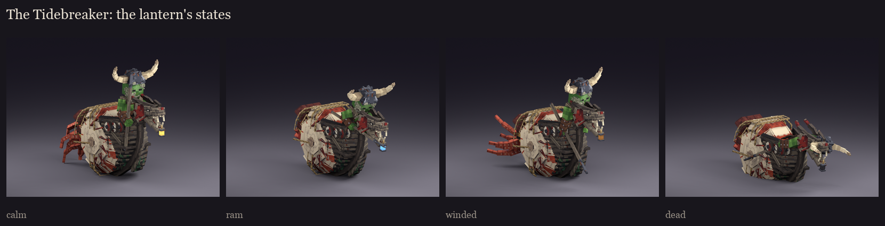
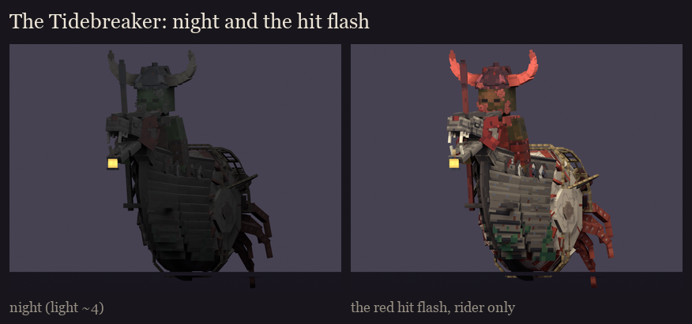

# The Tidebreaker, session 6: variants and readability

Made by `python tools/art/bosses/tide_s6.py <folder with the 26.2 zombie textures>`.

His only light is the lantern on the dragon's jaw. It is painted neutral, and a BetterModel per-bone tint on
`glow_lantern` colours it per state. In `/bm test` it shows white, because nothing tints it there.

| State | Tint | When |
|---|---|---|
| calm | (255, 214, 110) | the warm oil light |
| ram | (120, 190, 255) | the blue of the warning lane, during the warning and the charge |
| winded | (150, 104, 58) | guttering: the melee opening |
| dead | (44, 42, 46) | out |

No part swaps: the fight has no phases.

- **Night:** the lantern is the one bright point. His shape holds, but he is dark, since the zombie face has no glow.
- **Hit flash:** only the rider's model takes it, as only he can be hurt. It tells players at a glance which part is the
  target.
