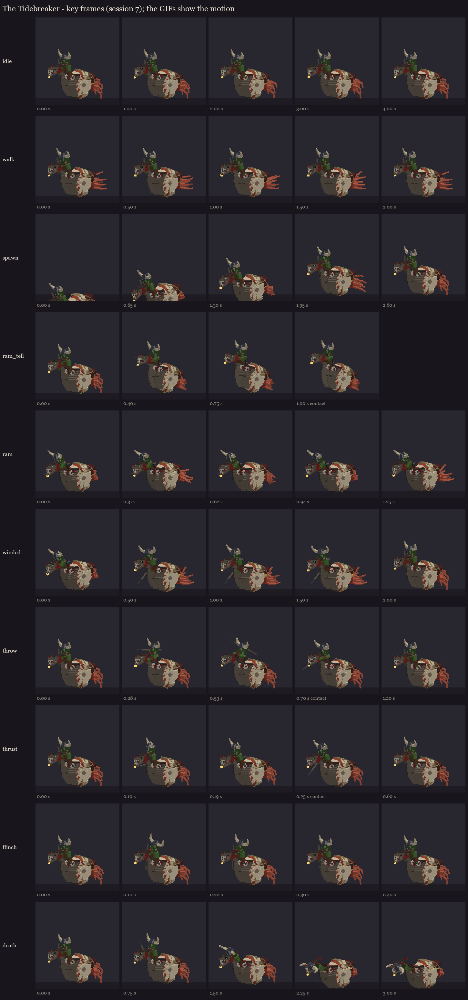

# The Tidebreaker, session 7: animation

Made by `python tools/art/bosses/tide_s7.py <folder with the 26.2 zombie textures>` (after `tide_s6.py`).

Motion previews: `gifs/`. In game: `/bm test occultech_tidebreaker_rig <clip>` and `/bm test occultech_tidebreaker_mount_rig <clip>`.

| Clip | Length | Plays | What happens |
|---|---|---|---|
| `idle` | 4.0 s | loop | the shell bobs, a wave runs down the tentacles, the lantern sways |
| `walk` | 2.0 s | loop | nose up, the tentacles streaming and pumping |
| `spawn` | 2.6 s | once | rising from the circle, the tentacles unfurling |
| `ram_tell` | 1.0 s | hold | the 20-tick warning: rears back, tentacles coil, spear couched |
| `ram` | 0.5 s | loop | the charge: bow down, tentacles pumping |
| `winded` | 2.0 s | once | the 40-tick opening: he sags, the eye snaps open and rolls, then recovers |
| `throw` | 1.2 s | once | drawn back; release at 0.7 s |
| `thrust` | 0.6 s | once | the jab; contact at 0.25 s |
| `flinch` | 0.4 s | once | hit (the Viking only) |
| `death` | 3.0 s | hold | he slumps over the bow; the animal pulls in and sinks |

## How the two models stay together

Both models have the same clip names, so the server plays one name on both. The Viking's clips carry the deck's pitch
and movement on his `rider` bone, so he stays on the deck when the mount rears or dips.

## For session 8

- The volley and the thrust happen instantly in the fight today. The clips need them delayed to their contact times:
  0.7 s for the volley, 0.25 s for the jab.
- The rider's real seat height on the nautilus still has to be measured and matched to the deck.

## Checked

Both rigs built on test server b with their clips and no BetterModel errors, but with no player online, so the motion
has only been seen in the previews. Every clip but `spawn` and `death` stays within the fight's 6.4-unit hover height.
