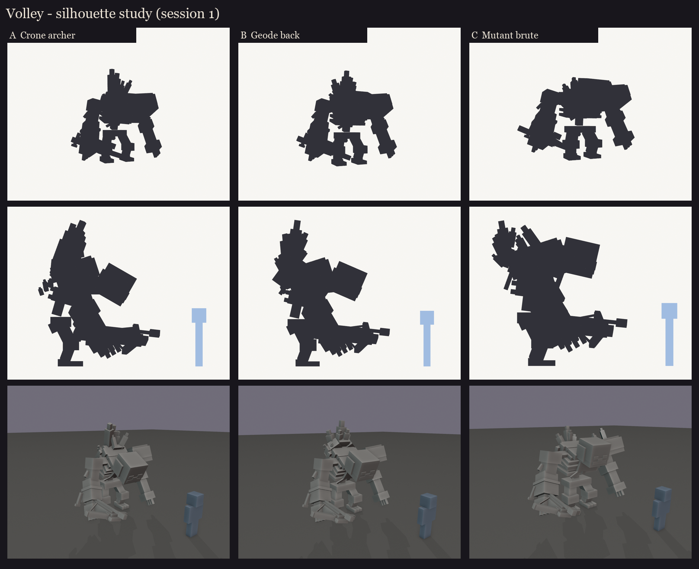
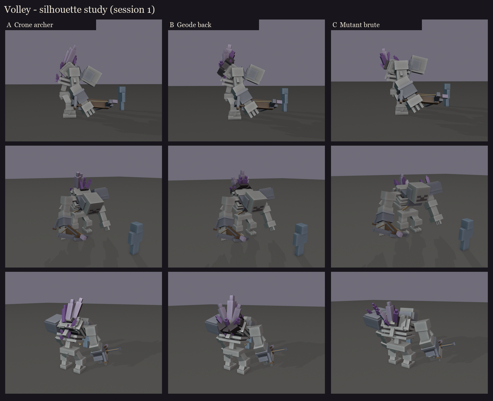

# Volley redesign, session 1: the Amethyst Crone

A buff, mutated vanilla skeleton that kept growing. He has a crone's stoop, armour on the upper body only, a geode
breaking out of his hump, and a steel arbalest in his right hand. Decisions from the review (2026-10-10):

- a 16-unit skull with the vanilla face doubled (each vanilla pixel becomes 2x2 texels);
- the back crystals brighten while Volley's amethyst wards stand and dim when the last one breaks;
- the counting jaw stays, split along the vanilla mouth row;
- the arbalest bolt has an amethyst tip.

These are blockouts for picking a direction: shapes and proportions only. Materials are flat colours, and the face
is marked with dark insets.

| | Direction | Stoop | Bulk | Crystals | Size (w x h x d, blocks) |
|---|---|---|---|---|---|
| A | Crone archer | deepest (46 deg, curved spine) | moderate | an uneven crest down the spine, biggest at the hump | 4.6 x 4.5 x 3.8 |
| B | Geode back | medium (36 deg) | heavier | one cracked geode on the hump (basalt rim, calcite, a fan of shards) plus stray buds | 5.0 x 4.7 x 3.8 |
| C | Mutant brute | slight (20 deg) | heaviest | a smaller cluster on the back, and shards breaking through the left pauldron | 5.7 x 4.2 x 3.9 |

Sheets per direction: [A](A/sheet.png), [B](B/sheet.png), [C](C/sheet.png). Editable blockouts:
[A](A/occultech_volley_crone_a.bbmodel), [B](B/occultech_volley_crone_b.bbmodel), [C](C/occultech_volley_crone_c.bbmodel).

What all three share:
- **Body:** cool grey-white bone like vanilla. A barrel ribcage with dark gaps between the ribs, long ape arms
  (the left knuckles nearly drag), and short bowed legs with three-toed feet.
- **Armour:** a big iron pauldron on the left shoulder, a gorget, a breastplate fragment over the ribs and a baldric
  across them, a bracer on the right forearm, and chainmail coif scraps on the skull.
- **Arbalest:** held at the right hip. A dark-oak stock, a steel prod with a stirrup, a windlass crank at the butt for
  the wind-up animation, and an amethyst-tipped bolt.
- **Back:** crystals follow vanilla amethyst's growth stages, from small buds to a full cluster, and grow out of
  geode layers (basalt, then calcite). The biggest 2-3 shards are the glowing ones (`glow_crystals`).

Known blockout shortcuts, to fix in session 2: the arbalest sits low (the fist is at shin height); the hitbox isn't
set yet; nothing has its final texel size yet.

Regenerate: `python tools/art/bosses/volley_crone_s1.py`. The earlier humanoid revision is kept in
[../s1_silhouettes](../s1_silhouettes/README.md).
