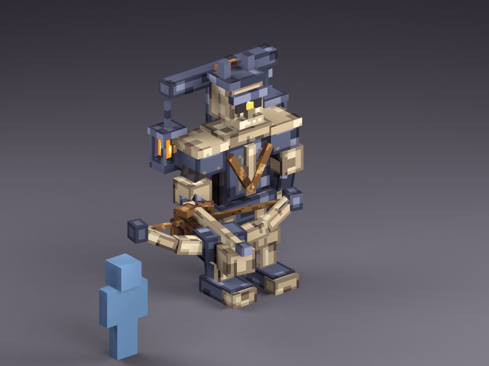

# Volley — Session 1 humanoid revision

Volley now reads as an armored skeletal arbalest bearer: a skull and articulated jaw above a broad human torso, two
arms, with the right hand carrying the crossbow at his side, and two planted legs. The left arm hangs relaxed. The small
execution yoke carries the two ward lanterns. The off-center weapon leaves the chest and waist visible. This revision
responds to feedback that the earlier four-legged siege-engine silhouettes were too grotesque; those files were removed.

- [Editable textured Blockbench model](occultech_volley_humanoid_textured.bbmodel) · [PNG texture atlas](occultech_volley.png)
- [Front texture view](textured_front.png) · [player-eye texture view](textured_player_eye.png) · [original silhouette sheet](sheet.png)
- [Untextured blockout](occultech_volley_humanoid.bbmodel)
- 95 cuboids, 24 named bones, 4.75 × 4.31 × 3.58 blocks (including the side-carried weapon). A blue 1.8-block player provides scale.

The model has movable groups for the head (`h_head`), counting jaw (`jaw_counter`), shoulders, forearms, hands, legs,
crossbow aim and draw, lanterns, and glow parts. These are pivots for later animation, not finished clips. The painted
256×256 atlas maps all 570 cuboid faces with separate UV islands. Dark slate iron and charcoal cloth frame aged bone,
the crossbow stock is dark yew, and only the eye, seals and captive wisps use ember light. The PNG is embedded in the
Blockbench file and also saved separately. Fractional blockout dimensions have UV spans rounded up to whole texels;
the main forms are approximately 16 pixels per block. [UV checks](texture_validation.json) record coverage and source identity.

The [Threateningly Mobs gallery](https://www.curseforge.com/minecraft/mc-mods/threateningly-mobs/gallery) remains a
reference for strong large shapes and selective glow. The model geometry and materials here are original.

The texture render is an offline preview. The artifact has not been imported into BetterModel or tested in game. For
the next modeling pass, check the side-carry and firing poses in game, plus the hitbox. Regenerate the
blockout with `python tools/art/bosses/volley_s1.py`, then its texture, UVs and rendered previews with
`python tools/art/bosses/volley_texture.py`.
