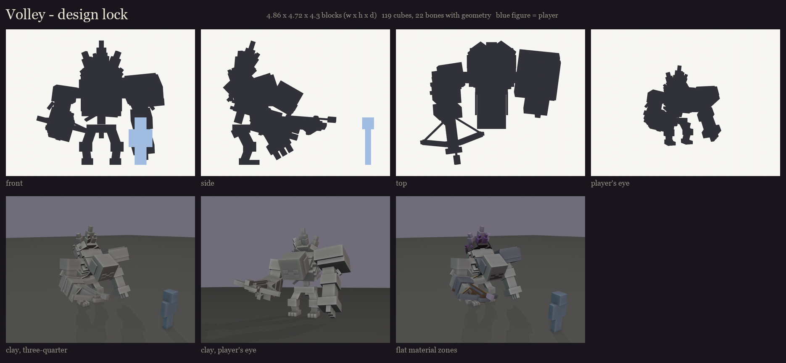
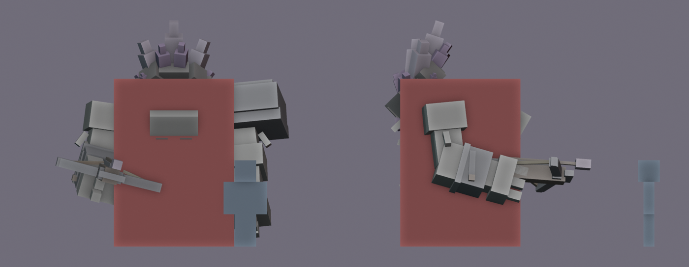
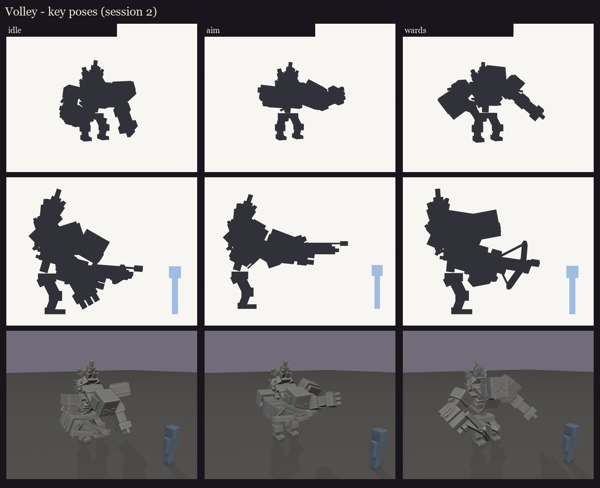

# Volley redesign, session 2: design lock (the Amethyst Crone)

Chosen in the session 1 review (2026-10-10): **A's posture, B's geode, C's arms**. That means the deep curved stoop
with the head hanging forward below the crystals, one cracked geode erupting from the hump, and the heavy gorilla
arms. Everything is real Blockbench cuboids, with every cube snapped to whole texels (16 per block).

## Size and hitbox

- **Model:** 4.9 x 4.7 x 4.3 blocks (w x h x d), including the arbalest and the crystal tips. The body itself is about
  3.5 blocks tall; the geode adds the last block.
- **Hitbox:** an invisible `ob_hitbox` bone, 2.5 x 3.5 x 2.5 blocks, centred on the body's mass and running from the
  feet to the top of the hump. The head, chest, hump and crystal roots are inside it. The arbalest, the crystal tips,
  and the outer edges of the fists and pauldron are not. BetterModel turns it into a hitbox entity that passes every
  hit on to Volley with the attacker kept.

## Key poses

These are the moments the fight shows, posed from the same rig. They are silhouettes for the design, not animation.

- **Idle:** the arbalest carried level at the right hip; the left knuckles nearly drag the ground.
- **Aim (the volley):** the arbalest raised to shoulder height and braced on the left forearm, the head lifted along
  the bolt. The burst comes from here.
- **Wards:** he rears up, the chest lifts, the arms spread and the geode is shown off. In game the glow crystals
  brighten here and stay bright while the wards stand.

The wind-up (cranking the windlass), recoil, stagger and death are left for the animation session: they depend on
timing and on the whole body dropping, not on a single pose.

## What changed since session 1

- The arbalest rides at the hip (the forearm swings up, the fist turns the weapon level); before, the fist was at
  shin height.
- The arms are C's: 1.45x bone thickness against a 1.2x body.
- The toes and heels were raised to stand exactly on the ground after snapping.

## Parts

[parts.md](parts.md) lists every bone with its parent, cube count and materials. Bones the rig and the Mythic skills
will use:

- `h_head` follows the aim;
- `jaw_counter` is the counting jaw, along the vanilla mouth row;
- `arbalest`, `arbalest_prod` and `windlass` are for the wind-up and the shot;
- `crystals_back` holds the geode, and `glow_crystals` holds the three lit shards (the ward glow);
- `ob_hitbox` is the hitbox.

Editable blockout: [occultech_volley_blockout.bbmodel](occultech_volley_blockout.bbmodel). Regenerate with
`python tools/art/bosses/volley_crone_s2.py`.

Next (session 3): pivots placed inside the joints, the bone names checked against BetterModel's tags, and six test
poses, with the blockout loaded on the test server so it can be seen in game.
