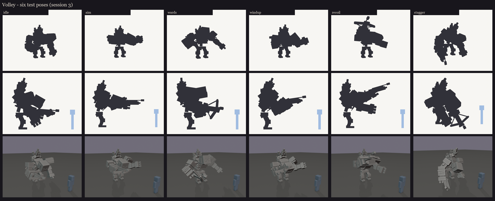
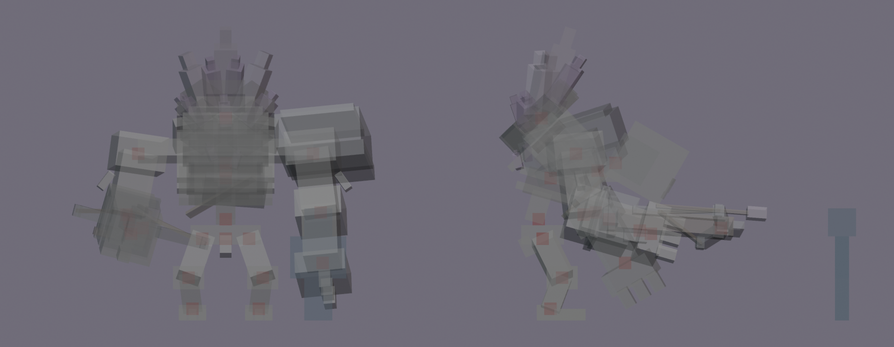

# Volley redesign, session 3: rig and pose test

This is the session 2 blockout made ready to move and to see in game: the joints checked, the bone names checked
against BetterModel, the drawing cost counted, six test poses, and a flat colour per material so BetterModel can show
it before texturing.



| Pose | What it tests |
|---|---|
| idle | carrying the arbalest at the hip, left knuckles low |
| aim | the burst: the arbalest at the shoulder, braced on the left forearm |
| wards | rearing up, the geode shown off (the crystals glow here in game) |
| windup | the crank: the arbalest pulled in, the left fist on the windlass |
| recoil | the bolt is away: the weapon kicks up, the chest rocks back, the jaw drops |
| stagger | a ward breaks: he twists away, the head lolls, the left arm catches him |

## Rig checks ([rig_report.json](rig_report.json))

- **Pivots:** all 22 bones pivot inside their joint ([pivots.md](pivots.md) gives each one's distance to its own
  cubes). The crystal bones were moved to the geode's root, so the ward flare can grow the crystals out of the hump.
  The jaw hinges at the back of the vanilla mouth row.

  
- **BetterModel tags:** BetterModel reads every `_`-separated word of a bone name as a possible tag (`h`, `b`, `ob`,
  `p`, `glow`, `li`, `ri`...). Only the intended bones carry one: `h_head` (follows the look), `glow_crystals`
  (full-bright) and `ob_hitbox` (the invisible hitbox).
- **Drawing cost:** 23 bones and 119 cubes, drawn as **56 display entities**. BetterModel keeps a cube inside its
  bone's item model only if it is turned by a single 22.5 or 45 degree step. Every other distinct rotation costs one
  more display. The geode alone is 18 (15 shards plus 3 glowing ones) and the arbalest's prod 5. Session 6 can trim
  this by sharing shard angles if it matters on the server; old Volley drew about 41.

## In game

The review model is `occultech_volley_rig`, with flat material colours and no texture yet. It sits in the test
server's `plugins/BetterModel/models` and is not shipped: the plugin still installs the textured model. The six poses
are saved as held animations.

```
/bm reload
/bm test occultech_volley_rig idle
/bm test occultech_volley_rig aim
/bm test occultech_volley_rig wards
/bm test occultech_volley_rig windup
/bm test occultech_volley_rig recoil
/bm test occultech_volley_rig stagger
/bm spawn occultech_volley_rig
```

Things to check in game:
- Each pose looks like the render above. If one bends the wrong way (an arm swinging back instead of forward), the
  animation sign convention needs flipping.
- The size against you (about 3.5 blocks of body, 4.7 with the crystals).
- The vanilla face reads at combat distance.
- Turning: the body follows the aim, and the head (`h_head`) leads it.

Regenerate: `python tools/art/bosses/volley_crone_s3.py` (it also copies the review model to the test server).

Next (session 4): UVs at one texel per unit, a packed atlas and a flat colour per material zone, then a grey-value
check.
